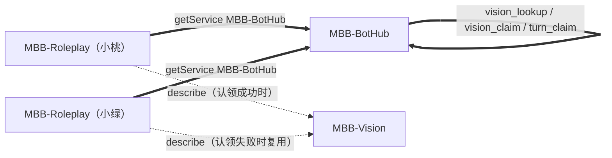

# MBB-BotHub

## 用途

同一个群里部署多个角色机器人时，每个 bot 都是独立进程、独立上下文、独立 AI 额度。
不协作会出现两类问题：

- 用户发一张图，两个 bot 各自调一次识图，同一张图识别两遍；
- 用户说一句模棱两可的话，两个 bot 都判断该回复，同一句话被回两遍。

MBB-BotHub 提供一层轻量的本地协作：

- **peer 注册**：每个 bot 上线时把自己的 `botID`、`botQQ`、角色名和参与的群报给 hub；
- **共享识图**：同一张图只有一个 bot 真正识图，其他 bot 复用结果；
- **回合权**：同一条消息只放行一个 bot 回复。

## 拓扑



一个进程当服务端，其他进程当客户端。服务端只维护内存状态，不写数据库，
重启后共享缓存和租约自然清空，不影响各 bot 自己的本地缓存。

## 首次启动与模式探测

插件初始化时探测本机 `18765` 端口：

```text
端口空闲      -> 生成 mode: "server"
端口被占用    -> 生成 mode: "client"
```

这样在多开场景下，先启动的实例自动成为 hub，后启动的实例自动连过去，不需要人工协调启动顺序。
配置写好后可以手工改成 `server` / `client` 固定下来，或者保持 `auto` 每次启动重新探测。

服务端监听地址默认 `0.0.0.0`，客户端连接地址默认 `127.0.0.1`。
跨机器部署时把客户端的 `host` 改成服务端 IP，并确保 `18765` 端口可达、`token` 一致。

## 身份自动补全

`botQQ` 和 `role` 留空时插件会在启动后自己补：

```text
botQQ  <- OneBot get_login_info 的 user_id
role   <- MBB-Roleplay identity 动作返回的当前 persona 名
botID  <- 补到 QQ 后用 QQ 号；否则用数据目录路径生成 bot-xxxxxxxx 稳定 ID
```

OneBot 还没连上时每 5 秒重试一次，最多 12 次。补全成功会写回 `config.yml`，
并就地更新链路身份：client 模式断开重连重新握手，server 模式重新登记本地 peer，都不需要重启进程。

这样处理是因为 `botID` 在 hub 内必须唯一：如果拿不到 QQ 就统一退化成 `bot`，
两个实例会互相顶掉连接，表现为「一个 bot 反复上下线」。现在改成按数据目录路径算稳定 ID，
同一台机器多开也不会撞车。

手工触发：

```text
/hub identity
```

控制台会打印补全结果：

```text
[BotHub] 身份自动补全 botQQ=1004331369 role=才羽桃井 botID=1004331369
```

## 共享识图流程

Roleplay 收到带图消息后：

1. 计算 key：`群号 + 消息ID + 片段序号`。两个 bot 收到同一条消息时算出同一把 key，
   不依赖图片 URL、文件名或 `file_unique` 是否为空。
2. `vision_lookup`：命中就直接复用，不调 `MBB-Vision`。
3. 未命中则 `vision_claim`：只有一个 bot 认领成功。
4. 认领成功的 bot 调 `MBB-Vision.describe`，再 `vision_publish` 广播结果。
5. 认领失败的 bot 用 `vision_wait` 等广播，拿到结果就复用；等待超时才回退本地识图，保证不丢描述。

服务端在 `vision_publish` 时把结果写入内存缓存（默认保留 72 小时、最多 500 条），
后续任何 bot 再遇到同一 key 都直接命中。

## 回合权流程

Roleplay 路由判定「要回复」之后，发送前先 `turn_claim`：

- 认领时带 `score`：被点名 100 / 被引用 80 / 延续自己参与的线程 60 / 泛群聊插话 40；
- 分数高者胜；同分用 `botID` 的稳定哈希比大小，保证两个进程独立算出的结果一致；
- 低分先到会被高分抢占，被抢的一方收到 `turn_preempted`，生成完成后、发送前再用
  `turn_status` 复核一次，发现被抢就放弃发送；
- 回复发送完成后 `turn_release`，租约默认 60 秒过期，进程崩溃也不会永久占位。

回合 key 用消息 ID：单条回合是 `m<消息ID>`，合批回合是 `b<批次最后一条消息ID>`。
如果两个 bot 的合批边界略有差异导致 key 不同，退化为各自回复，不会阻塞。

双方都被点名（例如「小桃小绿你们觉得呢」）时走 `multi` 分支：都放行，第二个按
`multiReplyStaggerMs`（默认 1500ms）错峰，避免同时刷两条。

多角色文本点名依赖各 MBB-Roleplay 进程的 `otherRoleBotNames` / `otherRoleBotQQs` 名单。
如果两个名单都为空，各进程无法确认消息同时指向多个角色，Hub 可能只给一个 bot 回合权。
建议在所有角色进程填写同一份角色名和角色 QQ 列表。

## 打字状态广播

赢了回合权的一方在开始生成前发 `typing start`，发完（或失败）发 `typing stop`：

```text
typing         {groupID, turnKey, state: start|stop}
typing_status  {groupID}  ->  {typing:[{botID, turnKey, expireAt}]}
```

服务端按群广播 `typing_started` / `typing_stopped`，只发给声明参与该群的 peer，
并按 `typingTtlSeconds`（默认 30 秒）过期清理，进程崩了也不会一直显示「正在输入」。
`/hub stats` 里的 `typingStarts` / `typingStops` 可以看广播频率。

## 任务去重

提醒这类「同一条消息只应该产生一个任务」的场景走 `task_claim`：

1. Roleplay 解析出提醒后，用 `reminder|群|用户|触发时间|目标|内容` 作为 key 去认领；
2. 认领成功的 bot 正常写库并发确认；
3. 认领失败的 bot 直接当作「已经有人建过」，不再重复确认。

租约默认 3600 秒，`/hub task clear` 可以清空。**生图 CD 仍然是每个进程独立**，不参与跨进程去重。

## 机器人互聊熔断

Roleplay 判断这条消息来自另一个角色机器人时，先问一次 `chat_guard`：

- 服务端按群累计连续 bot-to-bot 轮数，超过 `botChainLimit` 就进入 `botChainCooldownSeconds` 冷却；
- 冷却期内双方都不再互相接话，日志输出「机器人互聊触发熔断，本轮不接话」；
- 真人发言会把计数和冷却一起清零，熔断可以立刻恢复。

熔断是跨进程的，所以两个 bot 加起来也不会把互聊刷到失控。

## 主备与选主

```text
client 连续 failoverAfterAttempts 次连不上 -> 尝试绑定端口接管为 server
绑定成功 -> 就地切换成 server，重新注册服务，日志输出「已接管为 hubserver」
绑定失败 -> 说明别的节点先抢到了，继续作为 client 重连
server 绑定失败 -> 退回 client 等别人接管
```

端口绑定本身是互斥的，所以多个 client 同时抢也只有一个能成为新 hub，不需要额外的投票协议。
「原 server 后启动」时它会发现端口已被占用，自动退回 client，链路自愈。

## 识图别名与缓存回填

识图结果除主键 `群号+消息ID+片段序号` 外，还会按 `sha256`、`fileUnique`、`file`、`url` 建别名：

```text
sha256:<值>  unique:<值>  file:<值>  url:<值>
```

`vision_lookup` 支持一次传多个 key（`key` + `aliases`），按顺序取第一个命中。
client 握手成功后会调用 `MBB-Vision` 的 `dump` 把本地缓存批量灌进 hub（每次重连后最多 5 分钟一次），
所以两个 bot 即使主键不同，也能靠 `sha256` / `fileUnique` 命中同一份结果。

## 能力协商

client 在 `hello` 里上报 `caps`，服务端保存并在广播时过滤：

```text
vision / turn / task / chat_guard
```

没有声明某项能力的节点不会收到对应事件；`caps` 留空按「全支持」处理，兼容老版本 client。
`/hub peers` 会显示每个节点上报的能力。

## 统计

```text
/hub stats
```

输出运行时长、节点数、识图命中/未命中、认领次数、省下的识图调用、缓存回填条数、
回合权放行/拦截、回合抢占、错峰回复、打字广播、任务去重、互聊熔断、广播次数、peer 上下线。

## 安全

- 默认 `host` 是 `127.0.0.1`，只监听本机；
- 跨机器部署把 `host` 改成 `0.0.0.0` 或具体内网/公网地址，并同时改掉 `token`；
- 绑非本机地址且 token 仍是 `change-me` 时，插件会在启动时输出告警；
- 当前没有 TLS，跨公网部署请自行套隧道或反向代理。

## 配置项

| 配置 | 默认 | 说明 |
|---|---|---|
| `mode` | `auto` | `server` / `client` / `auto` |
| `host` | `127.0.0.1` | 服务端监听地址 / 客户端连接地址 |
| `port` | `18765` | TCP 端口 |
| `token` | `change-me` | 共享鉴权 token，所有 bot 必须一致 |
| `botID` | 空 | 节点身份，自动补全后取 QQ 号，同一 hub 内必须唯一 |
| `botQQ` | `0` | 机器人 QQ，留空自动从 OneBot 取 |
| `role` | 空 | 角色名，留空自动从 MBB-Roleplay 取 |
| `groups` | 空 | 参与协作的群号，英文逗号分隔，留空表示全部群 |
| `heartbeatSeconds` | `10` | 心跳间隔 |
| `requestTimeoutMs` | `3000` | 单次请求超时 |
| `reconnectSeconds` | `5` | client 断线重连间隔 |
| `leaseSeconds` | `30` | 服务端判定 peer 掉线的空闲秒数 |
| `visionShareEnable` | `true` | 是否共享识图结果 |
| `visionLeaseSeconds` | `30` | 识图认领租约 |
| `visionWaitMs` | `15000` | 等待其他 bot 识图结果的毫秒数 |
| `visionCacheKeepHours` | `72` | 共享识图缓存保留小时 |
| `visionCacheMaxEntries` | `500` | 共享识图缓存最大条目数 |
| `turnShareEnable` | `true` | 是否共享回合权 |
| `turnLeaseSeconds` | `60` | 回合权租约 |
| `typingTtlSeconds` | `30` | 打字状态广播的有效秒数 |
| `multiReplyStaggerMs` | `1500` | 双方都被点名时第二个回复的错峰延迟 |
| `taskLeaseSeconds` | `3600` | 跨进程任务去重租约 |
| `botChainLimit` | `4` | 同群连续 bot-to-bot 轮数上限 |
| `botChainWindowSeconds` | `180` | 熔断统计窗口 |
| `botChainCooldownSeconds` | `120` | 触发熔断后的冷却 |
| `caps` | `vision,turn,task,chat_guard` | 上报的能力列表，留空表示全部支持 |
| `autoFailover` | `true` | 是否自动选举新的 hub 服务端 |
| `failoverAfterAttempts` | `3` | 连续失败多少次后尝试接管 |

## 命令

```text
/hub                       查看状态
/hub peers                 查看节点
/hub mode server|client|auto
/hub reload
/hub reconnect
/hub identity
/hub stats
/hub task clear
/hub token <共享token>
/hub vision clear
```

权限 `BOT_ADMIN`。

## 部署步骤

1. 把 `MBB-BotHub.jar` 放进每个 bot 的 `plugins/` 目录。
2. 启动第一个 bot，确认控制台输出 `[BotHub] 首次生成配置，探测模式=server` 和
   `[BotHub] server 已启动，监听 0.0.0.0:18765`。
3. 启动其余 bot，确认输出 `[BotHub] 已连接 hubserver 127.0.0.1:18765`。
4. 每个 bot 的 `config.yml` 里把 `token` 改成同一个值，`botID` 保持唯一。
5. Roleplay 侧确认 `hubEnable: true`。
6. 在群里发一张图，观察控制台：应该只有一个 bot 输出 `[识图] AI识别`，另一个输出
   `[识图] 命中 hub 共享缓存` 或 `[识图] 复用其他 bot 的识图结果`。

## 排查

| 现象 | 排查方向 |
|---|---|
| 全部 bot 都是 server | 端口没被占用：先启动的实例会占用，检查是否有 bot 启动失败 |
| 全部 bot 都是 client | 端口被别的程序占用，换 `port` 或先关掉占用方 |
| `auth_failed` | 各 bot 的 `token` 不一致 |
| `hello_ok` 之后立刻断开 | `botID` 重复，后连上的会顶掉先连上的 |
| peer 显示 `qq=0` | OneBot 尚未连接，等自动补全重试，或 `/hub identity` 手工触发 |
| 两个 bot 都建了同一条提醒 | 确认两边都装了新版 `MBB-BotHub`，且 `hubTaskDedupEnable` 为 `true` |
| 角色突然不接另一个机器人的话了 | 多半是互聊熔断触发，`/hub stats` 看 `chatGuardBlocked`，等冷却或让真人说一句 |
| 原 server 重启后变成 client | 正常，说明端口已被接管的节点占用；`/hub mode` 可以改回来 |
| 共享识图一直不命中 | 确认两边都连在同一个 hub，且 `MBB-Vision` 版本支持 `dump` |
| 识图仍然识别两次 | 两个 bot 不在同一 hub；或 `visionShareEnable` 被关；或合批导致 key 不同 |
| 角色不回复了 | 检查是否被回合权拦下，日志会输出「回合权已归 xxx」 |
| 想彻底停用协作 | Roleplay 侧 `hubEnable: false`，或停用 MBB-BotHub |

## 与单机行为的关系

- 没有装 MBB-BotHub：Roleplay 走原路径，行为完全不变。
- 装了但没连上：`status.available=false`，Roleplay 立即回退本地识图、放行回合权。
- 识图认领失败等待超时：回退本地识图，宁可多识别一次也不丢描述。
- 回合权服务端异常：`turn_claim` 返回失败时 Roleplay 默认放行，不会把回复卡死。
