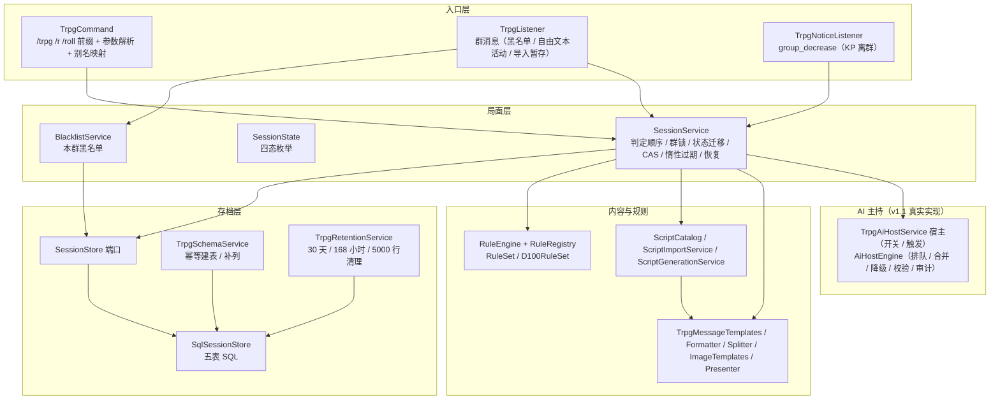

# MBB-Trpg

MoBoxBot 的 QQ 群跑团插件。第一版（v1）目标：一个群同时跑一局文本团，任何人可以开团并担任人类 KP，玩家用指令掷骰、检定、推进场景，结束后归档并出战报；AI 主持是 v1.1 的可选能力，v1 只锁契约。

本页是**唯一总规格**，规格定稿即开工依据。实现按本文另起 effort，本图不写代码、不构建、不发布。

状态：spec-frozen（2026-10-22）｜归属：设计规格「MBB-Trpg 跑团插件 · 第一版设计规格」的装配｜下游：实现切片、后续实现 effort。

## 1. 文档定位与范围

### 1.1 这份文档是什么

- **可直接开工的规格**：指令集、规则接口、数据模型、状态机、剧本格式、AI 主持契约、验收清单七件齐备，实现记录不再回头改契约。
- **契约层**：与本文冲突的实现视为缺陷；本文与来源冲突时以来源为准，并回写本文。
- **只产规格**：不新增功能、不改 `version.txt`、不打标签、不开 Release；发布版本号由实现 effort 决定。

### 1.2 章节与分册

| 章节 | 内容 | 详细分册 | 来源 |
| --- | --- | --- | --- |
| 2 | 产品定位与 v1 范围 | — | 设计规格 |
| 3 | 总体架构与模块职责 | — | 插件先例调研 / 存储契约实测 / d100 规则基线 / 指令集 / 数据模型与存档 |
| 4 | 规则接口与 d100 检定 | [ADR 0001](adr/0001-rule-engine-spi.md) | 规则引擎 |
| 5 | 局面状态机 | — | 指令集（局面状态机） |
| 6 | 指令集与权限矩阵 | — | 指令集 / AI 主持 / 剧本格式 |
| 7 | 数据模型与存档生命周期 | [ADR 0002](adr/0002-storage-consistency-without-transactions.md) | 数据模型与存档（数据模型） |
| 8 | 剧本格式与导入 | [剧本格式分册](scripts/README.md) / [ADR 0003](adr/0003-script-json-format.md) | 剧本格式 |
| 9 | AI 主持契约 | [ADR 0005](adr/0005-ai-host-degradation.md) | AI 主持（AI 主持契约） |
| 10 | 呈现规范 | [呈现规范分册](MBB-Trpg-presentation.md) / [ADR 0004](adr/0004-presentation-style-and-image-fallback.md) | 呈现规范（消息流原型） |
| 11 | 配置项总表 | — | 呈现规范 / 指令集 / AI 主持 / 数据模型与存档 / 剧本格式 |
| 12 | 验收清单 | — | 规则引擎 / 数据模型 / 指令集 / AI 主持 / 数据模型与存档 / 呈现规范 |
| 13 | 实现切片输入 | — | 实现切片 |
| — | 术语 | 见 §13 | 规则引擎 / 数据模型 / 剧本格式 / 呈现规范 / 指令集 / AI 主持 / 数据模型与存档 |

### 1.3 规范用语的力度

- **必须 / 不得**：实现与测试都可直接据此判失败。
- **应当 / 建议**：允许有理由的偏离，但要在实现记录里记录。
- **可以 / 可选**：留实现自由。
- 表格里的数字（冷却、超时、上限、字数）都是默认值；除标注「冻结」的外都进配置（见 §11）。

### 1.4 术语

领域术语以根目录 `GLOSSARY.md` 为唯一口径，每个词条带 `_Avoid_` 行列出禁用同义词。写作与代码命名（类名、字段名、日志）都必须用词表正名；同一概念出现第二种叫法即缺陷。本文出现的核心术语：局、局号、活跃局、局状态、局内成员、离场成员、旁观者、KP、剧本、线索、线索解锁、文本日志、事件序号、战报、归档、检定、成长检定、规则集。

## 2. 产品定位与 v1 范围

### 2.1 一句话定位

给 QQ 群一个「打开就能跑团」的轻量工具内核：指令驱动的骰子与检定、一键随机角色卡、群内一局、可导入的示例剧本、结束即战报；主持由人类 KP 负责，AI 主持在 v1.1 作为可选叙述员接入。

### 2.2 目标用户与场景

| 角色 | 关心的东西 | v1 给什么 |
| --- | --- | --- |
| 想开团的人 | 群里能直接开、不用装东西 | `/trpg start` 建局即成为 KP，内置示例剧本 |
| 想玩的人 | 加入快、骰子可信、卡不丢 | `/trpg join` 一键随机角色卡；检定全公开；重启后卡与局都在 |
| 群管理 | 不添乱、能止血 | GROUP_ADMIN 强制结束、本群黑名单；错误 10 秒去重 |
| Bot 管理 | 内容可控、可排查 | 剧本库导入 / 生成 / 删除；AI 默认关、审计只留元数据 |
| 围观的人 | 只看不打扰 | 只读状态与公开信息，不进私聊 |

### 2.3 v1 做什么

| 能力 | 范围 | 章节 |
| --- | --- | --- |
| 局与状态机 | 四态、七条迁移、重启恢复、惰性过期、每群一局 | §5 |
| 指令集 | `/trpg` 主命令族 + `/r` / `/roll`，英文主名与中文别名 | §6 |
| 规则 | 可插拔规则集 SPI + 内置 d100（三档难度、六档成功等级、奖惩骰、对抗、SAN、成长） | §4 |
| 角色卡 | 八属性随机生成、指令微调、SAN/HP/MP 推导、成功技能与成长 | §4 / §7 |
| 剧本 | 版本化 JSON、严格校验、分段导入、内置示例、AI 生成（管理员） | §8 |
| 存档 | SQLite 五表、无事务下的 CAS 与唯一索引、30 天归档清理 | §7 |
| 呈现 | 单一播报版式、字数预算、三种图片、失败回退文本、私聊安全 | §10 |
| AI 主持 | **只交付契约桩**：配置项、`/trpg ai` 参数解析、全局关拒绝、空实现 | §9 |
| 测试 | JUnit 4 契约测试（规则纯函数、SQLite 真库、假端口），构建脚本 `-Test` 开关 | §7.9 / §12 |

### 2.4 v1 不做（明确出界）

| 不做 | 原因 |
| --- | --- |
| 多群多局并行、跨群观战、跨群角色卡迁移 | 每群一局是 v1 的核心简化；跨群要重定义权限与存档 |
| 暗骰、回合 / 行动序、等待回应计时器、在线检测、自动超时踢人 | 属于 KP 主持习惯与群内环境机制，不是轻量内核 |
| 幸运消耗、推骰、完整疯狂表、症状表、SAN 归零后的永久疯狂流程 | 规则深度留给规则集与后续版本 |
| AI 真实调用与 AI 生图 / 语音 / 地图 / GM 控制台 | v1.1 及以后 |
| 对外插件 API、插件市场、QQ 文件上传解析剧本 | 超出「只依赖公开 API」与 v1 交付 |
| 数据库备份、导出、事务、关机钩子 | 主程序 API 0.3 冻结，不可行 |

### 2.5 v1.1 预留

- AI 主持真实实现（§9 的契约即 v1.1 唯一依据）；剧本生成的 AI 降级与主持的 AI 降级是两套，不得混用术语。
- 暗骰、多局、跨群共享上下文：需要先改 §5 的四态与 §7 的唯一索引，本规格不预留字段。

### 2.6 硬约束（实现不得突破）

| 约束 | 影响 |
| --- | --- |
| 只依赖 `org.moboxlab.moboxbot.API`；不碰主程序内部类、`BasicInfo`、数据库实现 | 图片只能用 `ImageUtil.renderText`；存储只能用 `StorageService` 七方法 |
| Java 8 + fastjson；中文注释与日志；不用 emoji | 所有代码与文档遵守 |
| `StorageService` 无事务，异常被吞（`update` -1 / 0、`insert` 0、`query` 部分行） | 只能「单语句即一次事务」+ 可重跑步骤（§7.4） |
| 插件表名必须 `plugin_mbb_trpg_*`，SQL 文本须含 `plugin_` 且不得含 `bot_` | 五表与八索引命名固定（§7.2） |
| 主程序定时器不持久化，进程退出不保证调 `onDisable` | 只做惰性结算 + 启动补做；没有「退出前落盘」 |
| 同一群的消息可能并发（共享 4 线程池） | 局面写入必须按群串行 + CAS（§5.5） |
| `AIService.chat` 同步阻塞、全局并发 2 | AI 调用必须进插件任务线程、设墙钟（§9.4） |
| 单类 800 行关注、1500 行先拆、2500 行停止扩展 | 服务边界见 §3.2；超过即拆 |

## 3. 总体架构

### 3.1 模块图



### 3.2 模块职责

| 模块 | 职责 | 不做什么 |
| --- | --- | --- |
| `TrpgCommand` | 注册 `/trpg` `/r` `/roll` 前缀；参数解析、英文主名 + 中文别名映射、私聊限制、框架权限声明 | 不持有局面状态、不落库 |
| `TrpgListener` | 插件消息入口：黑名单静默拦截、局内活动刷新（60 秒节流）、导入暂存吞消息 | 不做业务判定 |
| `TrpgNoticeListener` | 监听 `group_decrease`，KP 离群触发 T7 | 不猜其他成员身份 |
| `SessionService` | 局面（session / member）写入的唯一入口：群锁、判定顺序、状态迁移、CAS、惰性过期、重启恢复、结束归档编排、`readSnapshot` 与 AI 子状态写方法 | 不发消息、不生成战报图、不管黑名单与清理 |
| `SessionState` | 四态枚举 | — |
| `SessionStore` / `SqlSessionStore` | 持久化端口与唯一实现，承载全部 SQL；不做业务校验、不加锁 | 不读内存局面 |
| `TrpgSchemaService` | 幂等建表、建索引、`PRAGMA` 判重补列、SQL 合规自检 | 不 DROP、不重建、不做数据迁移 |
| `TrpgRetentionService` | 启动 + 每小时的清理编排；`runOnce(now)` 可测试 | 不清理活跃局与未结算局 |
| `RuleEngine` / `RuleSet` | 纯函数检定：难度、奖惩骰、对抗、SAN、成长 | 不读写库、不推进局面、不渲染文案 |
| `ScriptCatalog` | 剧本加载、校验、缓存、导入 / 删除 / 替换的引用检查与库级读写锁 | 不自动掷骰、不改局面 |
| `ScriptImportService` | 分段粘贴导入状态机（开始 / 片段 / end / cancel） | 不做校验规则本身 |
| `ScriptGenerationService` | `/trpg script gen` 一次性 AI 生成（单线程 daemon） | 不进 AI 主持队列、不写 `ai_trace` |
| `BlacklistService` | 本群黑名单 add / remove / list，直连 `SessionStore` | 不占群锁、不做跨群解封以外的事 |
| `TrpgPresenter` 六件套 | 模板、格式化、拆分、图片、出口与配置 | 不决定信息是否可见（归 §5 / §6） |
| `TrpgAiHostService` | AI 主持宿主服务：全局开关、触发入口、引擎装配与挂起/去重绑定 | 不写局状态；排队/合并/降级由 `AiHostEngine` 承担 |
| `Messaging` / `Clock` / `RandomSource` / `Scheduler` / `AiClient` / `TraceStore` / `SessionView` | 注入端口，测试用假实现 | — |

### 3.3 写入边界

- **局面写入**（session / member，含 AI 三列）只经 `SessionService`：群锁 + 单语句 CAS。
- **黑名单写入**由 `BlacklistService` 直连 `SessionStore`，不占群锁。
- **建表 / 补列 / 清理**由 `TrpgSchemaService` / `TrpgRetentionService` 直连 `SqlSessionStore`，不占群锁。
- 这三条路径互不调用对方；发送一律在锁外。

### 3.4 部署形态

- 独立插件目录 `MBB-Trpg/`，主类继承 `API.Plugin`，`plugin.json` 声明 `softDepend: MBB-AI`（未安装时插件仍可加载，AI 路径按 unavailable 降级）。
- 数据目录：`getDataFolder()` 下 `scripts/<scriptID>.json`（导入剧本）、`imports/rejected/`（最多 20 份被拒原文）、SQLite 五表。
- 内置剧本在 JAR 资源 `scripts/<id>.json`，只读、不可删改；同 id 时内置优先。
- 不打包公共依赖（fastjson 等由主程序提供）；JAR 产物归 `out/`，不入库。

## 4. 规则接口与 d100 检定

### 4.1 设计取舍

规则集是**编译期 SPI**：插件内定义 `RuleSet` 接口与 `RuleRegistry` 显式注册，`onEnable` 注册内置 `D100RuleSet`；配置只保存规则集 id（`ruleset: d100`），不暴露阈值、骰型、大失败口径。第三方规则集 = 本插件内新增实现类并发版，不做跨 JAR 发现。理由与备选见 [ADR 0001](adr/0001-rule-engine-spi.md)。

### 4.2 接口（Java 8 草图，实现即按此形状）

```java
package org.moboxlab.mbb.trpg.rule;

/** 检定类型：规则集id.类型，避免不同规则集撞名。 */
public final class CheckTypes {
    public static final String D100_SKILL  = "d100.skill";
    public static final String D100_SAN    = "d100.san";
    public static final String D100_GROWTH = "d100.growth";
}

/** 一次检定请求的标记接口；字段由各规则集自行定义。 */
public interface CheckRequest { String type(); }

public enum CheckDifficulty { REGULAR, HARD, EXTREME }

/** 技能/属性检定。skillValue 已由调用方把修正折算进来，引擎不再收 flatModifier。 */
public final class D100SkillCheck implements CheckRequest {
    private final String skillId;             // 可空
    private final String skillLabel;          // 展示名，如「侦查」
    private final int skillValue;             // 0..99，已含修正
    private final CheckDifficulty difficulty; // 默认 REGULAR
    private final int bonusDice;              // 0..2
    private final int penaltyDice;            // 0..2
    // 越界（奖惩骰 > 2、技能值 < 0）抛 RuleException
}

/** SAN 检定：损失表达式由剧本提供，引擎只掷骰与比较。 */
public final class D100SanCheck implements CheckRequest {
    private final int currentSan;
    private final DiceExpression successLoss; // X
    private final DiceExpression failureLoss; // Y
}

/** 成长检定：纯函数，不读写角色卡。 */
public final class D100GrowthCheck implements CheckRequest {
    private final int skillValue;
}

/** 骰子表达式值对象：由剧本加载器解析，引擎只负责掷。 */
public final class DiceExpression {
    public static DiceExpression constant(int value);
    public static DiceExpression dice(int count, int sides, int modifier); // 如 1D10
    public int roll(RandomSource random);
}

/** 随机源：注入以便测试固定骰面；默认实现 ThreadLocalRandom。 */
public interface RandomSource {
    int roll(int sides);           // 1..sides（含）
    default int d10() { return roll(10); }
}

/** 一次检定结果：只含检定数据与短句摘要，不含叙事文本。 */
public final class CheckResult {
    private final boolean success;        // 是否达到本次难度
    private final int degree;             // -1 大失败, 0 失败, 1 常规, 2 困难, 3 极难, 4 大成功
    private final RollTrace roll;         // 原始骰面，供日志与战报复盘
    private final String summary;         // 例：「困难成功（掷出 19 ≤ 22）」
    private final Integer sanLoss;        // 仅 SAN：应扣点数
    private final boolean sanTriggerInt;  // 仅 SAN：单次损失 >= 5，需上层发起 INT 检定
    private final int growthDelta;        // 仅成长：实际提升值
}

/** d100 骰面明细；已把 00+0 归一化为 100。 */
public final class RollTrace {
    private final int units;
    private final int baseTens;
    private final int[] bonusTens;
    private final int[] penaltyTens;
    private final int selectedTens;
    private final int normalized;   // 1..100
}

/** 规则集 SPI：无状态单例，线程安全。 */
public interface RuleSet {
    String id();                    // "d100"
    String displayName();
    boolean supports(String checkType);
    CheckResult resolve(CheckRequest request, RandomSource random) throws RuleException;
    OpposedResult resolveOpposed(OpposedCheck opposed, RandomSource random) throws RuleException;
}

public final class OpposedCheck { private final D100SkillCheck left; private final D100SkillCheck right; }
public enum OpposedOutcome { LEFT_WIN, RIGHT_WIN, NONE }
public enum OpposedTieBreak { LEVEL, SKILL, ROLL, ROLL_TIE, BOTH_FAIL, BOTH_FUMBLE }
public final class OpposedResult {
    private final CheckResult left;
    private final CheckResult right;
    private final OpposedOutcome outcome;
    private final OpposedTieBreak decidedBy;
}

/** 注册表：onEnable 显式注册；配置只存 id。 */
public final class RuleRegistry {
    public static synchronized void register(RuleSet ruleSet);
    public static RuleSet get(String id);            // 不存在返回 null
    public static RuleSet getOrDefault(String id);   // 未知回退内置 d100 并告警
}
```

### 4.3 内置 d100 数值表

| 项目 | v1 取值 | 理由 |
| --- | --- | --- |
| 骰读法 | 十位 × 10 + 个位；00 + 0 归一化为 100 | 官方快速开始；归一化后才能直接比大小 |
| 大成功 | 骰面 01 | 任何难度下都成功 |
| 大失败 | 技能值 < 50 → 96–100；技能值 ≥ 50 → 100；基准取**原始技能值** | 消除角色卡速查表的歧义；修正已折算进技能值后不再改基准 |
| 成功等级 | 极难 ≤ ⌊S/5⌋，困难 ≤ ⌊S/2⌋，常规 ≤ S；全部向下取整 | 难度只抬高「算成功的最低档」，失败线不变 |
| 奖励 / 惩罚骰 | 各 ≤ 2 颗，一比一抵消；奖励取最小十位，惩罚取最大十位 | 官方口径；抵消后单边最多 2 颗 |
| 对抗检定 | 成功等级 → 技能值 → 骰面低者胜；骰面相同 → `ROLL_TIE` 重掷一次 → 仍平则 `outcome=NONE`；双失败 `NONE`；双大失败 `BOTH_FUMBLE`（各担最坏后果） | 官方对抗规则；重掷只允许一次，避免无限平局 |
| SAN 损失 | X/Y 由剧本给：成功扣 X、失败扣 Y、大失败扣 Y 最大值；单次 ≥ 5 由上层发起 INT 检定；SAN=0 永久疯狂退场 | 「大失败取 Y 最大值」是本规则集的设计取舍 |
| 成长 | 1D100 **严格大于**技能值 → +1D10，封顶 99；无大成功 / 大失败 | 终止阈值单调，纯函数可单测 |
| 示例损失档位 | 轻 0/1D3、中 1/1D6、重 1D10/1D100 | 只作内置示例与 AI 生成默认值，不是引擎规则 |

### 4.4 检定类型与边界

- **技能检定**：`/trpg check` 与 KP 代掷；奖励 / 惩罚骰写在同一指令里，最多各 2 颗。
- **对抗检定**：只由 KP 发起；双方须为同一规则集的技能检定，一次调用返回双方明细与胜负依据。
- **SAN 检定**：只由 KP 发起；单次损失 ≥ 5 时 `CheckResult.sanTriggerInt=true`，由 `SessionService` 追加 INT 检定并记录临时性疯狂 1D10 小时（不做症状表）。
- **成长检定**：只在本局结束时结算（§5.3），不读写角色卡；`successSkills` 由局面层收集。
- **`/r` 与 `/roll`**：只支持 `[N]d[M]` 与常数相加、最多 3 段、N ≤ 20、M ≤ 1000；不支持乘除、括号、函数、条件、嵌套；bp / pp 不进 `/r`；不落库、不能掷技能检定。

### 4.5 v1 做 / 推迟

- **做**：三档难度、六档成功等级、大成功 / 大失败、奖惩骰（含抵消与上下限）、对抗一次调用完成、SAN（X/Y + INT 标记 + 归零标记）、成长纯函数、注入 `RandomSource` 并记录原始 / 选中骰面、`RuleSet` SPI + `RuleRegistry` + 内置 `D100RuleSet`。
- **推迟 / 不做**：幸运消耗与推骰；完整疯狂发作表与不定期疯狂；技能值 > 100 的破格例外；技能专精；成长自动打勾与章节结算；局级随机种子与回放；配置驱动规则集与跨 JAR 发现；大失败口径配置开关。

### 4.6 测试缝

规则引擎是纯函数层，主测试缝是 `RuleSet.resolve` / `resolveOpposed`，注入可记录骰面的 `RandomSource`，断言 `CheckResult` 的 `success` / `degree` / `sanLoss` / `growthDelta` 与 `RollTrace` 明细；不 mock 规则集内部、不断言 `summary` 文案（文案归 §10）。

## 5. 局面状态机

### 5.1 四态与成员级状态

| 局状态 | 含义 | 谁在什么情况下看到 |
| --- | --- | --- |
| 无局 | 本群没有未归档的局 | 新群、归档后（`/trpg status` 视为无局） |
| RECRUITING 招募 | 已开团、还没开局 | 玩家 `join` / `pc reroll` / KP 换剧本 |
| RUNNING 进行中 | 已开局、剧本与角色卡锁定 | 检定、场景、结束 |
| ENDED 已结束 | 归档态，保留 30 天供日志与战报查询 | `/trpg log`；不占「每群一局」名额 |

成员级状态与局状态正交：**局内成员**（已加入且未离开）、**离场成员**（已 `leave`，保留角色卡与局籍）、**旁观者**（未加入）。KP 是创建者且始终为局内成员。T2 的「至少 1 名」= **除 KP 外**至少 1 名局内成员（建局即插 KP 成员行，不能据此单人开局）；v1 不检测真实在线。

### 5.2 迁移表

| 编号 | 从 | 到 | 触发 | 前置 / 限制 |
| --- | --- | --- | --- | --- |
| T1 | 无局 | 招募 | `/trpg start` | 本群无未归档局；start 冷却 |
| T2 | 招募 | 进行中 | `/trpg begin` | 仅 KP；除 KP 外至少 1 名局内成员；剧本存在且校验通过 |
| T3 | 进行中 | 已结束 | `/trpg end`（二次确认） | KP 或 GROUP_ADMIN；30 秒内同一发起者第二次生效（确认按（群, 发起者）计，KP 与 GROUP_ADMIN 计数互不合并，确认状态不落库） |
| T4 | 招募 | 已结束 | `/trpg end`（二次确认） | 同上（确认按（群, 发起者）计，KP 与 GROUP_ADMIN 互不合并）；取消开团 |
| T5 | 招募 | 已结束 | 惰性过期 | 超过 24 小时未开局（可配置） |
| T6 | 进行中 | 已结束 | 惰性过期 | 超过 7 天无局内活动（可配置） |
| T7 | 招募 / 进行中 | 已结束 | KP 离群通知 | `group_decrease` 命中 KP |
| T8 | 招募 / 进行中 | 不变 | 进程重启 | 招募局加载后 `recovered=true`（视为已确认，无需 resume）；进行中局 `recovered=false`，群内一条【恢复】提示，KP 用 `/trpg resume` 确认 |

T1–T7 是状态迁移，T8 是恢复事件（不写库）。

### 5.3 迁移副作用与结束编排

| 迁移 | 副作用（字段与表见 §7） |
| --- | --- |
| T1 | 建 session：`state=RECRUITING`、`kpUserID=发起人`、`scriptID=参数或内置示例`、`ruleSetID=d100`、`lastActivityAt=now`；建 KP 成员行；群内公告 |
| T2 | `state=RUNNING`、`startedAt`、当前场景=剧本开场；开场叙述：AI 未启用用 §10 模板，AI 启用由 AI 生成（不重复发两条） |
| T3 / T6 / 进行中 T7 / 强制 | 走 RUNNING→ENDED 统一收尾（见下），`endReason` 依次 `finished` / `expired` / `kp_left` / `forced` |
| T4 / T5 / 招募期 T7 | 写结束摘要、直接归档、**不结算成长**，`endReason` = `cancelled` / `expired` / `kp_left` |
| T8 | 只置内存 `recovered`（招募局 `true`、进行中局 `false`），不改库 |

**统一收尾顺序（冻结）**：CAS 置 ENDED（写 `endedAt`、`endReason`、`growthSettled=0`、空 summary）→ 逐成员成长结算 → 写摘要并把 `growthSettled` 置 1 → 异步战报（失败回退文本）。否掉「先成长后归档」：崩溃后会二次成长。

**成长结算规则**：对本局成功用过的技能（`check` 检定为常规成功及以上，或作为对抗胜出方使用该技能；SAN 检定不计入）掷成长检定；每成员一条 UPDATE 同时写新 `cardJSON` 与清空 `successSkills`，卡与「已结算」标记同语句生效，重复结算不再涨点。

**摘要**：优先采用剧本 `endings` 中第一个所需线索全部解锁者的 `title` 与 `narration`（按 2000 字符截断），无匹配时用插件通用文本（§8）。

### 5.4 统一判定顺序与拒绝类别

固定顺序：**黑名单（静默）→ 是否群内（含私聊白名单）→ 权限 → 状态 → 参数 → 冷却 → 执行**。

- 黑名单在插件消息入口最前端，命令与自由文本都拦；命中静默、不回复、不处理、不记日志。
- 私聊无群上下文，不做群黑名单检查；BOT_ADMIN / OWNER 远程解封按参数中的群号查目标群，但请求者不受该群黑名单约束。
- 子命令识别属于分发，不占判定位次：`script` 首参数命中 `list / show / import / delete / gen` 走剧本库分支，否则走本局剧本分支；`import end` / `cancel` 先由消息入口按暂存态识别（整条消息去首尾空白后等于 `/trpg script import end` / `/trpg script import cancel`，大小写不敏感），命中后不进命令分发；暂存期间该用户同会话消息一律当 JSON 片段吞掉。
- **惰性过期不占判定位次**：在「读状态」的同一临界区内先执行 T5 / T6 归档，再按新状态继续权限 → 状态校验；过期是系统动作，不受请求者权限影响。
- 拒绝类别固定为：黑名单（静默）、请在群内使用、无权限、当前状态不可用（含本群暂无局）、参数不合法、冷却中、并发占用（本群正在处理上一条）、成员状态不满足（未入局 / 已在局 / 已离场 / 非 KP）。具体措辞归 §10。
- 同群同类错误 10 秒内只回复一次。

### 5.5 并发与落库

- 每群一把 `ReentrantLock`（按群号缓存，容量上限 + 空闲淘汰，或固定分段），入口 `tryLock`；拿不到回「本群正在处理上一条」。
- 临界区固定为：读状态 → 校验 → 迁移 → 落库；**临界区不包网络发送**，发送放锁外，锁在 `finally` 释放。
- 落库用单语句 CAS：`UPDATE ... WHERE id=? AND state=?`。`-1` = 语句未执行、状态未知 → 中止本步、记日志、不推进 `growthSettled`、不删父行，下轮重试；`0` = 前置不匹配 → 重读后按新状态拒绝或跳过。
- 不加全局锁、不跨群加锁；ENDED 行不参与「每群一局」唯一约束。
- `insert` 返回 0 无法区分「没插入」与「已插入但取键失败」：日志不重试；建局插入后先回读同群活跃局，有则视为已存在，仍无则按写入失败拒绝并告警。

### 5.6 冷却与错误去重

- 框架 `Command.cooldownSeconds()` 统一返回 0；权限主要由服务层判定（依赖局状态与成员身份），框架 `permission()` 不承担状态相关权限。
- 插件内部按（动作, 用户, 群）计冷却：`start` 30 秒、`/r` 与 `/roll` 2 秒、其余 1 秒；冷却判定在状态与参数校验之后。
- 同群同类错误去重窗口 10 秒。

### 5.7 重启恢复

- 启动顺序（冻结）：建表 / 补列 → 成长与摘要补做 → 清理 → 扫未归档 session → 逐局加载 member → 重建内存局面（进行中局 `recovered=false`，招募局视为已确认）→ 进行中的局每群一条【恢复】提示（招募期的局不发）。**先清后载**，避免把刚删的局加载回内存。
- 恢复只读，不因重建写库；不预载文本日志；ENDED 局不参与恢复。
- `recovered` 是「本进程刚加载」的内存事实，不落库；招募局加载即为已确认（`true`），进行中局初始 `false`，KP 执行 `/trpg resume` 后置 `true` 并写日志。
- 加载到活跃局但成员行为 0 → 按 T4 `cancelled` 归档并告警（覆盖「建局先写局、成员写入失败」窗口）。
- `ruleSetID` 未知 → 回退 `d100` 并告警，不阻断恢复。
- 恢复只是一次性确认，不冻结局；不做自动静默续跑；v1 无定时器，库即真相。

### 5.8 惰性过期与局内活动

- 惰性过期在任一 `/trpg` 指令或启动扫描时判定：招募超 24 小时未开局自动取消归档；进行中超 7 天无局内活动自动归档并提示；时长进配置。
- **局内活动**定义：本局成员在群内发出的任一消息（指令或自由文本，含 `status` / `help` / `log` 等只读查询）由消息入口调用 `SessionService.touchActivity(群号, 用户号)` 刷新，60 秒节流（实现按用户号判定是否本局成员）；旁观者与局外消息不计。否掉「只刷指令」：只靠自由文本活跃的局会被 T6 提前归档。

## 6. 指令集与权限矩阵

### 6.1 指令矩阵

主名 / 中文别名两套写法等价；未列别名即无中文别名。`/r` 与 `/roll` 是同一命令的两个前缀。

| 指令（主名 / 中文别名） | 权限 | 允许状态 | 语义 / 参数 | 私聊 | 冷却 |
| --- | --- | --- | --- | --- | --- |
| start / 开团 | EVERYONE | 无局 | `[剧本ID]`；建局进招募，省略用内置示例 | 否 | 30s |
| join / 加入 | EVERYONE | 招募 | 加入并生成随机角色卡；离场成员重进清离场标记 | 否 | 1s |
| leave / 离开 | 本局玩家 | 招募 / 进行中 | 保留角色卡与局籍；重进：招募期 join，进行中由 KP invite | 否 | 1s |
| begin / 开局 | KP | 招募 | 除 KP 外至少 1 名局内成员（v1 不检测在线） | 否 | 1s |
| end / 结束 | KP 或 GROUP_ADMIN | 招募 / 进行中 | 30 秒内同一发起者二次执行生效（按（群, 发起者）计，KP 与 GROUP_ADMIN 互不合并，不落库）；GROUP_ADMIN 的「强制」只表示无需 KP 同意 | 否 | 1s |
| resume / 恢复 | KP | 招募 / 进行中 | 仅 `recovered=false` 时有实际作用 | 否 | 1s |
| status / 状态 | EVERYONE | 任意 | 当前局与成员摘要；AI 启用时多一行 AI 状态；ENDED 视为无局 | 否 | 1s |
| help / 帮助 | EVERYONE | 任意 | 指令列表或单条说明 | 是 | 1s |
| pc / 角色卡 | 本局成员（自己，含离场）/ KP（任意） | 招募 / 进行中 | `[@玩家]` 查看角色卡 | 否 | 1s |
| pc reroll / 重掷 | 玩家本人 | 招募 | 重新随机自己的卡；SAN 重置为 POW | 否 | 1s |
| pc set / 微调 | 玩家本人 | 招募 | `<字段> <值>`；仅八属性且 15–90；改 POW 不联动 SAN；开局后锁定 | 否 | 1s |
| scene / 场景 | KP | 进行中 | `<标题>` 设当前场景并解锁本场景尚未解锁的 `clueIds`；写 `text_log` 的 clue 事件 | 否 | 1s |
| check / 检定 | 玩家本人；KP 代掷 | 进行中 | `[@玩家] <技能> [bp/pp [次数]]` | 否 | 1s |
| opposed / 对抗 | KP | 进行中 | `<@A> <技能> vs <@B> <技能或目标值>` | 否 | 1s |
| san / 理智 | KP | 进行中 | `<@玩家> <X/Y>`；损失 ≥ 5 追 INT 与临时疯狂 | 否 | 1s |
| adjust / 调整 | KP | 招募 / 进行中 | `<@玩家> <技能> <±值>`；写审计日志 | 否 | 1s |
| invite / 邀请 | KP | 进行中 | `<QQ>` 拉人入局；离场成员重进清标记 | 否 | 1s |
| take / 接管 | KP | 进行中 | `<@玩家>` 标记 KP 代管并写日志；status 显示「代管中」，KP 可代掷；目标成员重新加入（join / invite 成功）时自动清除代管标记 | 否 | 1s |
| skip / 跳过 | KP | 进行中 | `<@玩家> [原因]`；只写日志，v1 不自动判定 | 否 | 1s |
| log / 日志 | 本局参与者（KP 与加入过的玩家，含已离开） | 有局；或存在 30 天内归档行 | `[页码]` 回看最近一局文本日志；旁观者不可 | 否 | 1s |
| script / 剧本 | KP（换本局）；BOT_ADMIN / OWNER（剧本库） | 招募（换本局）；任意（库管理） | 首参数命中 list / show / import / delete / gen 走库管理，否则按本局剧本 ID；导入三段式；被活跃局引用的剧本禁止 delete 与 import replace | 库管理可私聊 | 1s |
| blacklist / 黑名单 | GROUP_ADMIN；BOT_ADMIN / OWNER 仅远程 remove | 任意 | 本群 add / remove / list；BOT_ADMIN / OWNER 私聊带群号 remove 解封 | 仅远程解封 | 1s |
| ai / AI 主持 | 见 §6.3 | 招募 / 进行中 | `on` / `off`；开关本局 AI 叙述，`on` 同时解挂起 | 否 | 1s |
| `/r`、`/roll` | EVERYONE | 任意（含局外） | 段相加表达式；不落库；不能掷技能检定 | 是 | 2s |

补充约束：

- 私聊只允许 `help`、`script` 库管理、`/r`、`/roll` 与 BOT_ADMIN / OWNER 远程解封；其余回「请在群内使用」。
- 私聊不做群黑名单检查；远程解封按参数群号查目标群。
- 剧本 ID 不得取 `list / show / import / delete / gen / end / cancel`，且不得以 `gen-` 开头（§8 保证）。
- 始终有剧本：`start` 省略剧本 ID 用内置示例，不设无剧本模式。
- 剧本中的 `checks` 与 `triggers` 只作 KP 提示与 AI 上下文：v1 不自动掷骰、不改状态、不自动发消息。

### 6.2 权限矩阵

| 动作组 | 旁观者 | 玩家 | KP | GROUP_ADMIN | BOT_ADMIN / OWNER |
| --- | --- | --- | --- | --- | --- |
| 状态 / 帮助 | 可 | 可 | 可 | 可 | 可 |
| 查看角色卡 | 不可 | 自己 | 任意 | 不可 | 不可 |
| 自助检定 / 改自己卡 / 离开 | 不可 | 可 | 仅代掷（不列自助检定） | 不可 | 不可 |
| 场景 / 代掷 / 对抗 / SAN / adjust / invite / take / skip | 不可 | 不可 | 可 | 不可 | 不可 |
| 结束 | 不可 | 不可 | 二次确认 | 强制结束 | 不可跨群结束 |
| 恢复确认（resume） | 不可 | 不可 | 可 | 不可 | 不可 |
| 日志回看（log） | 不可 | 可（含离场） | 可 | 不可 | 不可 |
| 剧本库管理 | 不可 | 不可 | 不可 | 不可 | 可 |
| 黑名单 | 不可 | 不可 | 不可 | 本群 add / remove / list | 远程 remove 解封 |
| AI 主持开关 | 不可 | 不可 | 开 / 关 | 关 | 开 / 关 |

GROUP_OWNER 不单列：群主满足 GROUP_ADMIN（`CommandSenderImpl` 口径），因此可强制结束与管本群黑名单；本规格没有仅群主可做的操作。

### 6.3 `/trpg ai` 增量（对 §6.1 的补充，来自 AI 主持）

| 指令 | 权限 | 允许状态 | 语义 | 私聊 | 冷却 |
| --- | --- | --- | --- | --- | --- |
| `ai on` | KP 或 BOT_ADMIN（含 OWNER） | 招募 / 进行中 | 打开本局 AI 叙述；清挂起、清失败计数、清本局去重缓存 | 否 | 1s |
| `ai off` | KP / GROUP_ADMIN / BOT_ADMIN（含 OWNER） | 招募 / 进行中 | 关闭本局 AI 叙述；挂起一并失效 | 否 | 1s |
| `ai`（无参数或其他） | 同上 | 招募 / 进行中 | 回复用法提示 | 否 | 1s |

全局 AI 未启用时 `ai on` 按「当前状态不可用」拒绝（不新增拒绝类别）。`/trpg status` 增加一行 AI 状态（关 / 开 / 挂起至某时刻）。不新增局状态：挂起是 AI 子状态。

### 6.4 指令行为约定

- 一条指令一条回执；同一事件不拆成多条（拆条规则见 §10）。
- 所有拒绝都落在 §5.4 的固定类别里，措辞由 §10 模板决定。
- 只读指令（status / help / log / pc 查看）也刷新局内活动（§5.8），但不改局状态。
- 命令层只做解析与委托；任何权限 / 状态判定都回 `SessionService`，避免两处口径。

## 7. 数据模型与存档生命周期

### 7.1 存储前提（必须理解再写代码）

主程序 `StorageService` 只有 7 个同步方法，没有事务，异常被吞：

| 返回 | 真实含义 | 处理 |
| --- | --- | --- |
| `update` → `-1` | 语句未执行（异常），状态未知 | 中止本步、记日志、不推进 `growthSettled`、不删父行、下轮重试 |
| `update` → `0` | 没有匹配行（DDL 成功也返回 0） | 重读后按新状态拒绝或跳过 |
| `insert` → `0` | 没插入 / 已插入但取不到生成键，不可区分 | 日志不重试；建局回读活跃局 |
| `query` → 部分行 / 空 | 异常被吞成已读到的部分行 | 视为「无数据 + 告警」，不据此删改数据 |

所有 SQL 必须经插件存储门面执行，文本须含 `plugin_` 且不得含 `bot_`；DDL 一律走 `update()`（`query()` 跑 DDL 会抛异常但不建表）。完整理由与备选见 [ADR 0002](adr/0002-storage-consistency-without-transactions.md)。

### 7.2 五张表与 DDL（可执行，冻结）

表名统一 `plugin_mbb_trpg_` 前缀；剧本正文不落库，session 只存 `scriptID`。

```sql
CREATE TABLE IF NOT EXISTS plugin_mbb_trpg_session (
  id INTEGER PRIMARY KEY AUTOINCREMENT,
  groupID INTEGER NOT NULL,
  state TEXT NOT NULL,
  kpUserID INTEGER NOT NULL,
  scriptID TEXT NOT NULL DEFAULT '',
  ruleSetID TEXT NOT NULL DEFAULT 'd100',
  sceneIndex INTEGER NOT NULL DEFAULT 0,
  sceneTitle TEXT NOT NULL DEFAULT '',
  startedAt INTEGER NOT NULL DEFAULT 0,
  endedAt INTEGER NOT NULL DEFAULT 0,
  endReason TEXT NOT NULL DEFAULT '',
  summary TEXT NOT NULL DEFAULT '',
  lastActivityAt INTEGER NOT NULL DEFAULT 0,
  aiEnabled INTEGER NOT NULL DEFAULT 0,
  aiSuspendedUntil INTEGER NOT NULL DEFAULT 0,
  aiFailStreak INTEGER NOT NULL DEFAULT 0,
  growthSettled INTEGER NOT NULL DEFAULT 0,
  createTime INTEGER NOT NULL,
  updateTime INTEGER NOT NULL
);

CREATE TABLE IF NOT EXISTS plugin_mbb_trpg_member (
  id INTEGER PRIMARY KEY AUTOINCREMENT,
  sessionID INTEGER NOT NULL,
  userID INTEGER NOT NULL,
  cardJSON TEXT NOT NULL DEFAULT '{}',
  successSkills TEXT NOT NULL DEFAULT '[]',
  joinedAt INTEGER NOT NULL DEFAULT 0,
  leftAt INTEGER NOT NULL DEFAULT 0,
  takenOver INTEGER NOT NULL DEFAULT 0,
  madnessUntil INTEGER NOT NULL DEFAULT 0,
  createTime INTEGER NOT NULL,
  updateTime INTEGER NOT NULL
);

CREATE TABLE IF NOT EXISTS plugin_mbb_trpg_text_log (
  id INTEGER PRIMARY KEY AUTOINCREMENT,
  sessionID INTEGER NOT NULL,
  seq INTEGER NOT NULL,
  eventType TEXT NOT NULL,
  actorID INTEGER NOT NULL DEFAULT 0,
  content TEXT NOT NULL DEFAULT '',
  createTime INTEGER NOT NULL
);

CREATE TABLE IF NOT EXISTS plugin_mbb_trpg_blacklist (
  id INTEGER PRIMARY KEY AUTOINCREMENT,
  groupID INTEGER NOT NULL,
  userID INTEGER NOT NULL,
  operatorID INTEGER NOT NULL DEFAULT 0,
  reason TEXT NOT NULL DEFAULT '',
  createTime INTEGER NOT NULL
);

CREATE TABLE IF NOT EXISTS plugin_mbb_trpg_ai_trace (
  id INTEGER PRIMARY KEY AUTOINCREMENT,
  groupID INTEGER NOT NULL,
  sessionID INTEGER NOT NULL DEFAULT 0,
  eventSeq INTEGER NOT NULL DEFAULT 0,
  triggerType TEXT NOT NULL,
  resultStatus TEXT NOT NULL,
  degradeReason TEXT NOT NULL DEFAULT '',
  errorType TEXT NOT NULL DEFAULT '',
  attempts INTEGER NOT NULL DEFAULT 1,
  elapsedMs INTEGER NOT NULL DEFAULT 0,
  finishReason TEXT NOT NULL DEFAULT '',
  usageJSON TEXT NOT NULL DEFAULT '',
  cached INTEGER NOT NULL DEFAULT 0,
  preview TEXT NOT NULL DEFAULT '',
  createTime INTEGER NOT NULL
);

CREATE UNIQUE INDEX IF NOT EXISTS ux_trpg_session_active ON plugin_mbb_trpg_session(groupID) WHERE state IN ('RECRUITING','RUNNING');
CREATE INDEX IF NOT EXISTS ix_trpg_session_cleanup ON plugin_mbb_trpg_session(state, endedAt);
CREATE INDEX IF NOT EXISTS ix_trpg_session_group ON plugin_mbb_trpg_session(groupID, state, endedAt);
CREATE UNIQUE INDEX IF NOT EXISTS ux_trpg_member ON plugin_mbb_trpg_member(sessionID, userID);
CREATE UNIQUE INDEX IF NOT EXISTS ux_trpg_log_seq ON plugin_mbb_trpg_text_log(sessionID, seq);
CREATE UNIQUE INDEX IF NOT EXISTS ux_trpg_blacklist ON plugin_mbb_trpg_blacklist(groupID, userID);
CREATE INDEX IF NOT EXISTS ix_trpg_trace_session ON plugin_mbb_trpg_ai_trace(sessionID, id);
CREATE INDEX IF NOT EXISTS ix_trpg_trace_cleanup ON plugin_mbb_trpg_ai_trace(createTime);
```

字段口径（冻结）：

- 时间一律 epoch 毫秒 INTEGER；布尔一律 0/1；`aiSuspendedUntil=0` 表示未挂起，不落 NULL。
- 有 DEFAULT 的列用默认值；`state`、`kpUserID`、`groupID`、`createTime`、`updateTime`、`eventType`、`triggerType`、`resultStatus`、`member.sessionID`、`member.userID`、`text_log.seq` 无 DEFAULT，写入必须显式给值；`summary` 缺失写空串，不写 NULL。
- `ai_trace.eventSeq` 固定 `NOT NULL DEFAULT 0`：0 表示没有触发它的日志，否则存触发它的那条日志 `seq`（AI 事件本身不写日志）。
- `ai_trace.triggerType` 取值冻结为 `scene / check / opposed / san / begin / merged / player_action`（与 §9.3 的触发路径一一对应）。`player_action` 只作为入窗原因，不单独落 trace：窗口结算统一写 `merged`，立即触发路径才写对应类型。
- 仅 `id` 使用 `INTEGER PRIMARY KEY AUTOINCREMENT`；不使用 BLOB，不存图片与剧本正文。
- 迁移补列必须带常量默认值，读取侧把 NULL 按默认值处理。

### 7.3 局号与对外标识

- 局号 = `session.id`，数据库自增、全局唯一、不回收；ENDED 行也保留局号，日志与战报可长期引用。
- 对外会话标识 `trpg-<群号>-<局号>` 只用于日志、战报与 AI 服务（v1.1 作 `x-opencode-session`），不落库、不作查询键。
- 每群同时最多一个**活跃局**，由部分唯一索引兜底，不依赖「读后写」；锁内先读检查给友好文案，插入失败回读兜底。

### 7.4 写入粒度与流程

- 局与成员：每个动作同步单语句写；不把「先写 A 表再写 B 表」当原子操作。
- `lastActivityAt` 60 秒节流（§5.8）；成员行没有该列，不随成员语句写。
- 日志：局锁内取 `COALESCE(MAX(seq),0)+1` 后 INSERT；`insert` 返回 0 不重试（重算 seq 会重复写），只记插件日志并跳过该事件；单条 `content` 截断 2000 字符；`/trpg log` 每页 10 条按 seq 倒序；只写白名单事件类型（清单见下），自由文本与 `/r` 不写。
- 线索解锁不建表：`eventType=clue`、`content=clueKey`、`actorID=触发者`，随业务日志在群锁内追加；读取 = 查本局 clue 事件的 content 去重；重复解锁允许重复写，读取侧按集合去重。
- 成功技能集合：群锁内读取、合并去重、单语句 `UPDATE member SET successSkills=?`。
- 黑名单：`UNIQUE(groupID, userID)`，永久，不随局清理；重复拉黑不产生重复行。
- 角色卡整体以 JSON 文本存 `cardJSON`，读写在行对象层解析，不拆多列。

**事件类型白名单（`text_log.eventType`，共 15 种）**：`create / join / leave / begin / scene / check / opposed / san / adjust / growth / invite / take / skip / resume / end`；不在表内的类型不写日志，自由文本与 `/r` 不写。

**建局（T1）流程**：群锁内查活跃局（有则拒绝）→ `INSERT session`（groupID、RECRUITING、KP、scriptID、ruleSetID、`lastActivityAt=now`、createTime / updateTime=now，其余取默认）→ `insert` 返 0 则回读同群活跃局，有则视为已存在，仍无则按写失败拒绝 → `INSERT member`（KP 自己，`sessionID`、`userID`、`cardJSON={}`、`successSkills=[]`、`joinedAt=now`）→ 成员插入失败则 CAS 置 ENDED(`cancelled`) 并报错，避免留下无 KP 的活跃局 → 写 `create` 日志。

### 7.5 角色卡数据契约（实现直接引用，不另立一套）

- `cardJSON = {attrs, skills, san, hp, mp, items}`；`attrs` 为八属性 `STR/CON/SIZ/DEX/APP/INT/POW/EDU` 的整数；键缺失或解析失败按默认值处理并告警。
- `pc set` 只接受八属性且每项 15–90 的整数（与 3D6×5 范围一致），越界拒绝；SAN / HP / MP 是当前值，由创建与伤害 / 恢复规则推导，`pc set` 不直接改；技能只由 KP `adjust` 改；`items` 由剧本 `startingItems` 给，是字符串数组，`pc set` 不含 items。
- `pc reroll` 重置 SAN = POW；`pc set` 改 POW 不联动 SAN；开局后卡锁定（T2）。
- 权限、群锁与提示归 §5 / §6，本表只管数据形状。

### 7.6 恢复加载

约束：恢复只读、不预载日志、ENDED 不加载、`recovered` 不落库；成员行按 `sessionID` 逐局查询（含离场、代管、临时疯狂、成功技能集合）；没有对应未归档 session 的成员行不进入内存局面。顺序见 §5.7。

### 7.7 归档与清理

- **归档**：ENDED 与活跃局同表，写 `endedAt` / `endReason` / `summary`；`endReason` ∈ `finished / cancelled / expired / forced / kp_left`，未知值按空串读入并告警；战报异步生成、不落库、失败回退文本，重启丢失可接受。
- **清理触发**：`onEnable` 一次 + 每小时一次；单次失败不阻塞，下次周期再试。
- **局清理**：只选 `state='ENDED' AND growthSettled=1 AND endedAt < now-30d`；按 `text_log → member → session` 顺序删除；任一条子表 DELETE 返回 -1 或删除 0 行（预期应有行）都中止本局、不删父行、下轮重试；**未结算的 ENDED 局永不清理**。
- **审计清理**：先删 `createTime < now-168h`，再按「保留最新 5000 行」截断；行数不足 5000 时不误删。
- 黑名单不清理；活跃局不清理；清理不依赖内存快照。

清理语句（冻结）：

```sql
SELECT id FROM plugin_mbb_trpg_session WHERE state='ENDED' AND growthSettled=1 AND endedAt < ?;
DELETE FROM plugin_mbb_trpg_text_log WHERE sessionID = ?;
DELETE FROM plugin_mbb_trpg_member WHERE sessionID = ?;
DELETE FROM plugin_mbb_trpg_session WHERE id = ? AND state='ENDED';
DELETE FROM plugin_mbb_trpg_ai_trace WHERE createTime < ?;
DELETE FROM plugin_mbb_trpg_ai_trace WHERE id < (SELECT id FROM plugin_mbb_trpg_ai_trace ORDER BY id DESC LIMIT 1 OFFSET 4999);
```

### 7.8 降级与迁移

- 建表 / 建索引 / 补列一律经 `StorageService.update`：DDL 成功返回 0、异常返回 -1；-1 即**禁用 TRPG 功能并提示**，不 DROP、不重建、不做破坏性迁移。
- 缺列：`PRAGMA table_info` 与期望列比对后 `ALTER TABLE ADD COLUMN`（SQLite 不支持 `ADD COLUMN IF NOT EXISTS`）；PRAGMA 读失败或空结果按读失败处理，不盲目 ALTER；只增不改不删，新增列必须带常量默认值。
- 读失败：只告警并按已有数据继续，不据此删除或改写；恢复少成员由下一次重启补齐。
- 写失败分两类：-1 中止本步、下轮重试；0 重读后按新状态拒绝或跳过。日志与审计写入失败只记插件日志，不阻断主流程。
- 不假设 `onDisable` 会被调用；不依赖进程退出落盘；不依赖 `/reload` 重读插件配置。
- 幂等：`CREATE ... IF NOT EXISTS`；无 schema 版本号；每次 `onEnable` 全量重跑；建表、补列、清理、恢复加载都可重入。

### 7.9 存储测试契约

- 唯一新增存储协作端口 `SessionStore`；`ensureSchema` 与 `runOnce(now)` 是可直接驱动的入口，不新增协作对象。端口方法语义以 数据模型与存档 为准（`findActiveByGroup` / `casSession` / `touchActivity` / `listUnsettledSessions` / `listClueKeys` / AI 子状态写 / `ai_trace` 截断等），本文不重复签名；`SessionService.readSnapshot` 至少返回 `sceneVersion`（最新事件 seq）、AI 三列、成员公开状态与已解锁线索键，供 AI 提示装配与假 `SessionView` 使用。
- 契约测试连**真 SQLite**（主程序 MoBoxLib 自带 `org.sqlite.JDBC` 3.45.x，生产同版本，不引第二个驱动）；每个测试一个临时文件库；测试期 `JdbcStorageFake` 实现 `StorageService` 并复刻已实测语义（autocommit、insert 返回生成键 / 失败 0、update 返回受影响行 / 失败 -1、DDL 成功 0、query 异常返回部分行、SQL 文本校验），带故障注入（`failNextUpdate` / `failNextInsert` / `failNextQuery` / `failNextQueryException`）。
- 必须覆盖：五表八索引幂等创建；`ALTER TABLE` 补列与 PRAGMA 判重；同群活跃局唯一索引冲突；成员 / 日志 seq / 黑名单唯一约束；-1 与 0 分开处理的约定；query 部分行不崩不删；T1 成员插入失败回滚归档；清理三边界与子表失败中止父删、`growthSettled=0` 永不清理；成长幂等（卡与 `successSkills` 同语句、重复结算不涨点）；线索 clue 事件可读回；SQL 文本合规；字符截断（日志 2000、审计 preview 240）。
- 测试载体：JUnit 4.13.2 + hamcrest-core 1.3，仅测试期依赖，不打进插件 JAR；构建脚本新增 `-Test` 开关，首次从 Maven Central 下载两个 jar 到插件 `out/test-libs/` 并校验同名 `.sha1`，失败则构建失败并打印 URL 与原因，不静默跳过；`out/` 不入库、jar 不提交；CI 在「Build plugins」后增加「Run tests」步骤。

## 8. 剧本格式与导入

完整字段、校验清单与样例见 [剧本格式分册](scripts/README.md) 与 [ADR 0003](adr/0003-script-json-format.md)；本节只锁实现必须遵守的契约。

### 8.1 文件来源与加载

| 来源 | 位置 | 规则 |
| --- | --- | --- |
| 内置 | JAR 资源 `scripts/<id>.json` | 只读、不可删改；同 id 时内置优先 |
| 导入 | `dataFolder/scripts/<id>.json` | UTF-8（允许 BOM）、≤ 65536 字节；命中内置 id 直接拒绝 |

- `onEnable` 全量校验并缓存；没有 reload 命令，手工改文件需重启插件。
- `schemaVersion` 固定为 1；`ruleSet` 当前只接受 `d100`。
- 元素 id 统一正则 `^[a-z0-9][a-z0-9-]{0,31}$`，全剧本唯一；场景标题唯一；所有引用必须存在。

### 8.2 顶层与节点（摘要）

- 顶层：`schemaVersion`、`id`、`name`、`author`、`description`、`ruleSet`、`minPlayers`、`maxPlayers`、`estimatedMinutes`、`tags`、`startingItems`、`scenes`、`clues`、`npcs`、`checks`、`triggers`、`endings`。
- `scene`：`id/title/narration` 必填；可选 `summary`、`fallbackNarration`、`clueIds`、`npcIds`、`checkIds`；数组顺序即场景顺序，第一个是开场。
- `clue`：`id/name/unlockedText` 必填，可选 `lockedSummary`（给 AI 的未解锁后果摘要，防剧透）。
- `npc`：`id/name/role/public` 必填，可选 `secret`（只给 KP 与 AI 上下文）。
- `check`：`type` 为 `d100.skill`（必填 `skill`，可带 `difficulty/bonusDice/penaltyDice`）或 `d100.san`（必填 `loss`，形如 `X/Y`）；只是建议检定，不自动掷骰、不绑定 `/trpg check`。
- `trigger`：`when` 为 `scene-enter / clue-unlocked / check-resolved`，目标字段严格对应，可选 `result`；只产出 KP 提示。
- `ending`：`id/title/narration` 必填，可选 `requiredClueIds`；进行中结束时按数组顺序取第一个所需线索全部解锁者，都不满足用插件通用文本。

### 8.3 校验与错误模型

- 结构用 JSON Schema draft-07 描述，跨字段语义由校验器补齐；**全有或全无**，任何 `E_` 级错误都不落盘、不覆盖旧文件。
- 错误带 `code`、JSON path 与中文消息，最多回 5 条；未知字段只告警（`W_UNKNOWN_FIELD`）不阻断。
- 错误码至少覆盖：`E_SIZE / E_PARSE / E_ROOT / E_VERSION / E_RULESET / E_ID / E_RESERVED / E_BUILTIN / E_EXISTS / E_DUP / E_FIELD / E_RANGE / E_REF / E_IO / E_IN_USE / E_NOT_FOUND / E_IMPORT_STATE / E_AI_*`。
- 「码 → 触发条件」以 [分册错误码表](scripts/README.md) 为准，易混的四个在此点名：`E_BUILTIN` = 与内置剧本 id 冲突或删改内置；`E_ID` = id 不合正则，或以 `gen-` 开头；`E_EXISTS` 只指新建导入时目标 id 已存在；`E_RESERVED` = 使用保留字。

### 8.4 导入三段式

1. `/trpg script import` 或 `/trpg script import replace` 开始；按（会话, 用户）建内存暂存。
2. 管理员把 JSON 原文分成一条或多条消息发送；插件按原始文本直接拼接，不插入分隔符，不执行也不回复。
3. `/trpg script import end` 解析、校验、原子写入；`/trpg script import cancel` 取消。

约束：暂存 5 分钟空闲或 30 分钟绝对超时；上限 65536 字节 / 200 段；暂存期间该用户同会话的任何消息都当片段接收，只有整条消息去首尾空白后恰好等于 `/trpg script import end` 或 `/trpg script import cancel`（大小写不敏感）时才按控制字处理；解析失败视为可能没传完、保留暂存；语义校验失败清暂存并把原文存入 `imports/rejected/`（最多 20 份）。

### 8.5 AI 生成（与主持解耦）

- `/trpg script gen <题材> [人数] [时长分钟]`，BOT_ADMIN / OWNER，人数默认 3、时长默认 60，60 秒冷却，全局单槽位，插件自有单线程 daemon executor。
- 调用 MBB-AI `chat`（`timeoutSeconds=90`、`maxTokens=6000`），要求只输出 JSON；解析后剥一层 Markdown 围栏、id 覆盖为 `gen-<yyyyMMddHHmmss>-<4位36进制>`、`author` 缺省 `MBB-AI`，再走与导入完全相同的校验与原子写入。
- 不写 `ai_trace`、不进 AI 主持队列、不受本局 AI 开关影响。
- 失败分类 `E_AI_DISABLED / E_AI_BUSY / E_AI_TIMEOUT / E_AI_OUTPUT / E_AI_VALIDATION / E_AI_FAILED`；一律不落盘，原文存 rejected，回复必须给出手动退路（修正后分段导入，或换题材重试）。

### 8.6 删除、替换与引用检查

- 内置剧本不可删改；导入剧本被任何未归档局（含重启恢复的局）引用时禁止删除或替换，返回 `E_IN_USE`。
- 引用检查经 `ScriptUsageIndex` 窄端口由 `SessionService` 实现：每次检查读取 `SessionStore.loadActiveSessions()` 的未归档局（含重启恢复）并按 `scriptId` 匹配；查询或装配失败按「被引用」处理（fail-closed），不为引用检查新增 `SessionStore` 方法。
- 为消除「检查后、插入前被删」窗口，`ScriptCatalog` 设库级读写锁：T1 / T2 解析剧本并插入局期间持读锁，`delete` / `replace` 的检查加文件操作持写锁；锁序固定为**先群锁后库读锁**；`delete` / `replace` 不取群锁；读锁不覆盖网络发送。

### 8.7 内置示例

`coc-example`「雨夜古宅」：2–4 人 / 60 分钟；4 scene、4 clue、2 NPC、3 check（2 技能 + 1 SAN 1/1D6）、3 trigger（三种 `when` 各一）、3 ending（4 线索真相 / 2 线索脱身 / 空数组兜底）。校验 0 错误、引用全部存在，是 v1 的默认剧本与验收样本。

### 8.8 剧本测试契约

- 校验器：覆盖 18 条校验清单（分册「校验规则与错误模型」）与错误码；同 id 冲突、保留字、`gen-` 前缀、引用缺失、范围越界、未知字段告警。
- 导入状态机：分段拼接、end / cancel、超时、超限、解析失败保留、校验失败清暂存并落 rejected、被拒原文上限 20 份。
- 引用检查与删除竞态：活跃局引用时拒绝；读写锁下检查与插入的顺序。
- 生成失败分类：六类 `E_AI_*` 都有明确表现与手动退路，且不落盘、不写 `ai_trace`。

## 9. AI 主持契约（v1 只锁契约）

定位：AI 是**回合叙述员**，不是代理 KP——只读局面、只产叙述文本与可选建议动作、**零状态变更**。详细决策与备选见 [ADR 0005](adr/0005-ai-host-degradation.md)；真实实现归 v1.1。

### 9.1 不变量

- AI 只读：不写 session、不写角色卡、不写日志、不触发状态迁移；副作用只有群消息、审计行，以及经 `SessionService` 提交的 AI 子状态写入。
- 不绕过 §5.4 判定顺序、§6.2 权限矩阵与 §5.5 单语句 CAS；AI 调用发生在群锁之外，不参与 CAS。
- AI 子状态（`aiEnabled` / `aiSuspendedUntil` / `aiFailStreak`）统一经 `SessionService`（群锁 + CAS），`TrpgAiHostService` 只提交写请求。
- **全局关时零 AI 调用、零审计写入、不注册 AI 定时器、不发任何 AI 提示**；行为与纯工具模式完全一致。
- 只在进行中调用；无局、招募、已结束一律不调 AI（公告走模板）。
- stale 判定只用 `sceneVersion`：定义为「本局最新事件 `seq`，无事件时为 0」，不新增列、不落库，重启后由日志重算；任何推进局面的指令（scene / check / opposed / san / begin 等）写入新事件即令其增大；AI 结果返回时版本不匹配即丢弃并记 stale。
- 审计写入尽力而为：失败只写插件日志，不阻断叙述、不计入失败。

### 9.2 三层开关

| 层 | 默认 | 谁能改 | 生效方式 |
| --- | --- | --- | --- |
| 全局 `aiHost.enabled` | false | BOT_ADMIN（含 OWNER）改配置 | 只在插件加载时读取；`/reload` 不重载插件配置 |
| 按局 `aiEnabled` | T1 建局固定 false | KP 用 `/trpg ai on`（招募期或局内） | 经 `SessionService` 落库（**v1 桩不落库，自 v1.1 起落库**） |
| 挂起 `aiSuspendedUntil` | 0 | 系统写、KP 用 `ai on` 清除 | 惰性比较 `Clock`，重启后仍生效 |

### 9.3 触发与合并窗口

- **立即触发**（不进窗口）：`/trpg scene` 推进、KP 代掷的 `check` / `opposed` / `san` 结算、`begin` 后的开场叙述。
- **合并窗口**：局内成员自由文本行动与玩家本人发起的自助 `check`；同群 20 秒或 5 条事件先到先触发，5 条先到时立即结算并取消定时器；窗口键只认局号，同局内场景推进不打断窗口，结算时取窗口内最新场景版本判断过期；窗口内事件按事件序号拼接为一次调用，玩家行动原文与判定摘要一并进入提示词动态段。
- 同一事件只走一条路径：玩家自助 check 并入窗口，KP 代掷立即触发。
- 关键节点固定为 `begin / scene / check / opposed / san` 与合并出的 `merged`，没有独立的「线索发放」触发：新线索随场景叙述一次交代。
- 去重键：局号 | 场景版本 | 窗口首序号 | 窗口末序号；同键只调用一次，结果缓存 60 秒；`/trpg ai on` 只清当前局缓存。
- 窗口定时器不持久化，重启丢窗不补发。

### 9.4 排队与并发

- 每群一条串行队列，待发上限 3；插件全局并发 2，全局等待上限 4；超限不排队，直接 `queue_full` 降级。
- 承载群任务的工作池另有硬上限：线程数 `max(2, 生效并发×2)`、待执行队列容量 `max(2, min(globalQueue, 生效并发))`；池满时同样按 `queue_full` 降级（先清本群积压再逐条审计），不向监听线程抛异常。
- 队列项记入队时间，等待超过 65 秒即按 `queue_full`（reason=`queue_age`）降级并移出。
- 超时双层：插件墙钟 45 秒（`Future.get`，到点按 timeout 降级并立即释放插件槽位）；传给 MBB-AI 的 `timeoutSeconds=10`；`retryCount=0`。
- 调用放入插件任务线程，不阻塞事件监听线程；插件全局并发 2 是本插件上限，v1.1 启动时读 `AIService.status()` 的 `maxConcurrent`，取 `min(2, 实际值)`。
- 队列只在内存，重启丢弃、不补发；授权、失败计数、挂起时间戳落库。

### 9.5 降级表（行为冻结，数值取 §11 默认值）

| 情形 | 判定点 | 动作 | 审计 |
| --- | --- | --- | --- |
| 全局关 / 本局未授权 | 调用前 | 纯工具模式，不调用、不发提示、不写审计 | 不写 |
| MBB-AI 未安装（服务 null）/ disabled / interrupted / 未列出 errorType | 调用前或返回时 | 不重试、不计入失败；模板叙述 + 提示 | `unavailable` 或原样 errorType |
| 队列已满（每群 3 / 全局 4） | 入队前 | 模板叙述 + AI 暂不可用提示 | `queue_full` |
| 队列超龄（等待 > 65 秒） | 出队时 | 模板叙述 + 提示 | `queue_full`（reason=queue_age） |
| 返回 busy | 返回时 | 不重试、计入失败；模板叙述 + 提示 | `busy` |
| 插件墙钟 45 秒到点 | 到点时 | 放弃等待、立即释放槽位、计入失败；模板叙述 + 提示 | `timeout` |
| network / http_4xx / http_5xx | 返回时 | 不重试、计入失败；模板叙述 + 提示 | `network` / `http_<code>` |
| 验证拒绝且重试后仍失败 | 校验后 | 计入 1 次失败；模板叙述 + 提示 | `verification` |
| 同局连续 3 次失败（成功清零） | 计数后 | 挂起 10 分钟、群内提示一次、清空本群待发队列（被清项记 skipped） | `suspended` |
| `finishReason=length` | 校验后 | 按成功处理，截断到 300 字 | success + truncated |
| 合并窗口内无新内容 | 触发前 | 不调用、不写 | 不写 |
| 结果返回时场景版本已变 | 发送前 | 丢弃不发 | `stale` |

空输出、超长截断后为空、解析不出任何叙述 → 按验证失败处理。`queue_full`、未授权、`unavailable`、`interrupted` 不计入失败计数；`busy / timeout / network / http / verification` 计入。失败来源以 MBB-AI `chat` 失败体的 `errorType` 为准（缺失时回退 `code`），`network` 与 `http_<code>` 原样透传。验证失败时：第 1 次验证拒绝只记 `attempts=1`、不计失败；按 `aiHost.retryCount=0` 重试一次后仍失败才计入 1 次失败。

### 9.6 挂起与恢复

- 连续 3 次失败把 `aiSuspendedUntil` 写为 now + 10 分钟，并把 `aiFailStreak` 清零；0 哨兵表示未挂起。
- 挂起判定惰性（每次请求前比 `Clock`），重启后按落库时间戳继续生效；挂起期间不再调用。
- 挂起动作同时清空本群待发队列；在途请求照常收尾，若已挂起则结果丢弃并记 `skipped`。
- 挂起提示每个挂起周期只发一次，由设置挂起的动作触发；挂起期间再有触发（指令或自由文本）时，直接按当前挂起周期回一次挂起提示后丢弃，不再静默消失；重启不补发；`/trpg ai on` 清挂起并重置计数，`/trpg ai off` 使挂起自然失效。挂起不会自动解除。

### 9.7 输出契约与防越权

- 输入输出都是 MBB-AI 清洗后的纯文本（`AIService` 对所有 content 无条件 `toPlainText`）；契约按清洗后文本处理。
- 叙述正文 ≤ 300 字（按清洗后字符计，不含落款与降级提示），超出截断并记 `truncated`；落款与提示文案归 §10。
- 可选建议动作单独一行，前缀「建议：」，最多 3 条；白名单大类为调查 / 观察、交谈 / 询问、移动 / 前往、等待 / 休息、使用 / 查看物品、尝试技能（只写技能名，不写数值与结果）；非白名单行整行丢弃；解析前先剥掉行首 `- ` / `* ` / `+`（`MarkdownUtil` 会把行首 `*` / `+` 归一为 `- `）。
- **断言语义扫描**：命中 HP / 生命值 / SAN / 理智 / 属性或技能加减数值、检定成败结论、替 KP 宣布推进 → 视为越权，丢弃该段并重试一次，再失败整条走模板。
- 不做剧透过滤（成本高、误杀多），靠分层素材与审计抽查兜底。
- AI 叙述与模板叙述必须有**可区分落款**；模板叙述必须含「AI 暂不可用」提示。只有挂起与降级路径发提示；全局关与未授权不发提示。

### 9.8 提示词骨架与素材

- 三段：稳定前缀（剧本核心设定 + 已登场 NPC 卡）、可缓存中段（风格与规则约束摘要）、动态区（当前场景、在场角色与公开状态标签、最近事件、已解锁线索原文、未解锁线索后果摘要、KP 最近叙述）。
- 预算总长 6000 字，动态区至少保留 1500 字，素材按优先级裁剪。
- 在场角色只给匿名代号（玩家A、玩家B……，按当前在场成员顺序编号；成员退出后其余代号可能前移重新编排）与公开状态标签（受伤 / 昏迷等），不给具体数值，也不给 QQ 号。
- 未解锁线索只给 `lockedSummary`，已解锁给 `unlockedText`。
- 系统提示固定约束：你是回合叙述员；不改数值、不代替做检定结论、不推进回合、不复述系统播报与指令回执；300 字以内；只输出叙述与可选建议行。
- 剧本无场景级 `fallbackNarration` 时，回退插件内置通用模板。

### 9.9 审计

- 端口 `TraceStore`，默认写 `plugin_mbb_trpg_ai_trace`（字段见 §7.2）。
- 每次入队请求最多写 1 行（含 `attempts`），不按调用次数重复写；结果状态 ∈ `success / degraded / suspended / stale / skipped`。
- **取值落列映射**：`resultStatus` 只取 `success / degraded / suspended / skipped / stale`；`degradeReason` 存触发原因（`queue_full / queue_age / timeout / network / http_<code> / busy / unavailable / interrupted / verification / truncated` 等）；`errorType` 只存外部错误码（`busy / timeout / network / http_<code> / unavailable` 等），输出校验失败固定写 `verification`，中文原因只进日志。
- `skipped` 只在挂起清队列与在途请求被丢弃时写；全局关、未授权、窗口无内容不写行。
- 不存完整提示词与完整输出，只存输出前 240 字预览；受 `aiHost.traceEnabled` 控制（默认开）；保留 168 小时 / 最多 5000 行（§7.7）。

### 9.10 sessionId 与 v1.1 交付

- AI 会话标识 `trpg-<群号>-<局号>` 同时作为本地键与 MBB-AI `chat` 的 `sessionId`（写入 `x-opencode-session`）；依据 `docs/MBB-AI.md`，opencodego 要求每个对话请求携带稳定会话头；返回 `cached=true` 按成功处理并记录。该标识不含用户身份。
- **v1.1 交付**：`/trpg ai on|off` 是真实开关，授权、连续失败计数与挂起时间戳落库（`aiEnabled` / `aiFailStreak` / `aiSuspendedUntil`，只经 `SessionService` 群锁内 CAS 写入）；全局 `aiHost.enabled=false` 时零调用、零审计、不注册定时器；全局开时按 §9.3–§9.9 触发、合并、排队、降级与审计，叙述与降级文案见呈现规范 §4.3。
- **挂起语义**：连续失败达到 `aiHost.suspendFailStreak` 后本局挂起 `aiHost.suspendMinutes` 分钟，期间触发直接回挂起提示；`/trpg ai on` 会清除挂起并重新开启。
- **v1.1 验收**：`/trpg ai` 四分支（无参数/on/off/全局关）、挂起提示、重启后挂起与授权生效、失败计数清零、审计每请求至多一行；验收记录见 [验收记录](MBB-Trpg-acceptance.md) 的 v1.1 补测段。

### 9.11 AI 测试缝

- 主缝 `AiHostEngine`：直接构造引擎，注入假 `AiClient`（成功 / 空输出 / 超长 / 越权断言 / busy / timeout / network / http_5xx / disabled / cached / `finishReason=length`）、假 `Scheduler`、可控 `Clock`、假 `SessionView`、内存 `TraceStore`、假 `AiNarrationSink` 与假 `AiFailureRecorder`。覆盖降级表每一行、单请求 2 次调用与计次、挂起惰性与重启生效、去重与 60 秒缓存、合并窗口三种收口、队列超龄、stale、300 字截断、建议白名单、审计字段与 240 字截断、审计失败不影响叙述、全局关零调用零审计零发送。
- 门面缝 `TrpgAiHostService`：开关判定与挂起清缓存只测门面，不重复覆盖引擎内部路径。
- 次缝 `TrpgCommand` 的 `/trpg ai` 与监听器入口：参数、无参数提示、私聊拒绝、权限与状态判定、全局关拒绝、自由文本与指令前缀分流。`SessionView` 的实现委托 `SessionService.readSnapshot`，测试只注入假实现。

## 10. 呈现规范

消息文案、版式、字数预算、图片与回退全部收口到 [呈现规范分册](MBB-Trpg-presentation.md)，本文**不复制**文案；实现只许引用，不许另写一套。这里只锁不可协商的六条：

1. **版式唯一**：群内只用 A 播报风 `【标题】`（最多两级，第二级用 ` · ` 分隔，如 `【检定 · 聆听】`），标题取自冻结 29 词表；`presentation.style` 配置位只接受 `broadcast`。
2. **两级字数预算**：群内单条硬上限 500 字、私聊 1200 字；每类消息另有内容上限（如检定 200、场景 400、战报 600、AI 叙述正文 300）。
3. **超长处理**：按段落 → 行 → 强标点 → 弱标点回扫拆分，最多 3 条（第 2、3 条标题加 ` · 续 n/3`），仍超出折叠成「……（本条还有 N 字，发送 /trpg log 查看）」；私聊不拆只折叠；列表类每页 10 条。
4. **图片只做三种**：情景卡（≤14 行）、战报（≤22 行）、剧本打印页；只用 `ImageUtil.renderText` 760px，不引入 AWT；角色卡与检定不发图。
5. **回退冻结**：渲染或投递失败 → 记 WARN → 改发同字段纯文本 → 不重试、不影响状态；**秘密绝不回退到群内**（线索全文、KP 提示、NPC `secret` 私聊失败只提示）。
6. **拒绝话术统一**：`【错误】<原因>。可发送 <下一步指令>。` 的骨架；黑名单静默；冷却与并发占用用 `【提示】`；同群同类错误 10 秒去重。

## 11. 配置项总表

所有数值都是默认值；标注「冻结」的不得配置化。配置文件为插件 `config.yml`，分节命名。

| 配置键 | 默认 | 说明 | 来源 |
| --- | --- | --- | --- |
| `ruleset` | `d100` | 规则集 id；不暴露阈值与骰型 | 规则引擎 |
| `session.recruitExpireHours` | 24 | 招募过期（T5） | 指令集 |
| `session.runningExpireDays` | 7 | 进行中无活动过期（T6） | 指令集 |
| `session.confirmWindowSeconds` | 30 | 结束二次确认窗口 | 指令集 |
| `cooldown.startSeconds` | 30 | 开团冷却 | 指令集 |
| `cooldown.diceSeconds` | 2 | `/r` `/roll` 冷却 | 指令集 |
| `cooldown.defaultSeconds` | 1 | 其余指令冷却 | 指令集 |
| `errorDedupeSeconds` | 10 | 同群同类错误去重 | 指令集 |
| `activityThrottleSeconds` | 60 | 局内活动刷新节流 | 数据模型与存档 |
| `log.maxContentChars` | 2000 | 单条日志截断 | 数据模型与存档 |
| `log.pageSize` | 10 | `/trpg log` 每页条数 | 呈现规范 |
| `retention.sessionDays` | 30 | ENDED 局保留天数 | 数据模型与存档 |
| `presentation.style` | `broadcast` | 只接受 broadcast | 呈现规范 |
| `presentation.groupMaxChars` | 500 | 群内单条硬上限 | 呈现规范 |
| `presentation.privateMaxChars` | 1200 | 私聊单条硬上限 | 呈现规范 |
| `presentation.splitMax` | 3 | 最多拆几条 | 呈现规范 |
| `presentation.sceneImage` | true | 情景卡开关 | 呈现规范 |
| `presentation.reportImage` | true | 战报图开关 | 呈现规范 |
| `presentation.imageMaxLines` | 22 | 战报图最大行数 | 呈现规范 |
| `script.maxBytes` | 65536 | 剧本文件与导入上限 | 剧本格式 |
| `script.importIdleMinutes` | 5 | 导入暂存空闲超时 | 剧本格式 |
| `script.importMaxMinutes` | 30 | 导入暂存绝对超时 | 剧本格式 |
| `script.importMaxSegments` | 200 | 导入分段上限 | 剧本格式 |
| `script.rejectedMaxFiles` | 20 | rejected 原文保留份数 | 剧本格式 |
| `script.genCooldownSeconds` | 60 | 剧本生成冷却 | 剧本格式 |
| `aiHost.enabled` | false | 全局 AI 开关（仅加载时读取） | AI 主持 |
| `aiHost.deadlineSeconds` | 45 | 插件墙钟 | AI 主持 |
| `aiHost.providerTimeoutSeconds` | 10 | 传给 MBB-AI 的超时 | AI 主持 |
| `aiHost.retryCount` | 0 | 应用层重试（仅验证失败重试一次） | AI 主持 |
| `aiHost.maxConcurrent` | 2 | 插件全局并发（再与 MBB-AI 取 min） | AI 主持 |
| `aiHost.perGroupQueue` | 3 | 每群待发上限 | AI 主持 |
| `aiHost.globalQueue` | 4 | 全局等待上限 | AI 主持 |
| `aiHost.queueMaxAgeSeconds` | 65 | 队列超龄 | AI 主持 |
| `aiHost.mergeWindowSeconds` | 20 | 合并窗口时长 | AI 主持 |
| `aiHost.mergeWindowEvents` | 5 | 合并窗口事件数 | AI 主持 |
| `aiHost.suspendFailStreak` | 3 | 连续失败挂起阈值 | AI 主持 |
| `aiHost.suspendMinutes` | 10 | 挂起时长 | AI 主持 |
| `aiHost.dedupeCacheSeconds` | 60 | 去重缓存 | AI 主持 |
| `aiHost.promptBudgetChars` | 6000 | 提示词总预算 | AI 主持 |
| `aiHost.dynamicMinChars` | 1500 | 动态区最小预算 | AI 主持 |
| `aiHost.narrationMaxChars` | 300 | 叙述正文上限 | AI 主持 / 呈现规范 |
| `aiHost.traceEnabled` | true | 审计开关 | AI 主持 |
| `aiHost.traceKeepHours` | 168 | AI 审计保留小时 | AI 主持 / 数据模型与存档 |
| `aiHost.traceMaxRows` | 5000 | AI 审计最大行数 | AI 主持 / 数据模型与存档 |

注：审计保留两项在 [ADR 0005](adr/0005-ai-host-degradation.md) 与 AI 主持 中冻结为 `aiHost.traceKeepHours` / `aiHost.traceMaxRows`；早期草稿的 `retention.traceHours` / `retention.traceMaxRows` 作废，实施时改名、不保留旧键。全表 44 项，其中 `aiHost.*` 19 项。

## 12. 验收清单（可逐条执行）

每条包含前置、操作与预期；全部通过才算 v1 验收完成。测试执行方式见 §7.9（JUnit 4 + 真 SQLite + 假端口；`-Test` 构建开关在同节）。

计数口径：共 86 条（表内 87 行，J5 拆为 J5a/J5b 两行）；J12（20 秒合并窗口）属 v1.1 能力，v1 验收标 N/A。本轮逐条执行记录见 [验收记录](MBB-Trpg-acceptance.md)。

### A. 构建与测试载体

| 编号 | 操作 | 预期 |
| --- | --- | --- |
| A1 | `.\build-all.ps1 -Bot <MoBoxBot.jar>` 全量构建 | 全部 MBB-* 构建成功，根 `out/` 汇总含 `MBB-Trpg.jar` |
| A2 | 检查 JAR 根目录 | 有 `plugin.json`；主类继承 `API.Plugin`；不打包 fastjson 等公共依赖 |
| A3 | 在 `MBB-Trpg/` 目录首次执行 `.\build.ps1 -Test` | 下载 junit 4.13.2 与 hamcrest-core 1.3 到 `MBB-Trpg/out/test-libs/`，sha1 校验通过后编译并运行测试（根目录 `build-all.ps1` 不跑测试） |
| A4 | 默认构建（不带 -Test） | 不跑测试、不下载测试 jar，产物与 A1 一致 |

### B. 指令与权限矩阵

| 编号 | 操作 | 预期 |
| --- | --- | --- |
| B1 | 逐条执行 §6.1 全部主名 + 中文别名 | 每条都被识别；未列别名回「参数不对」或按未知子命令拒绝，不被识别为其他指令 |
| B2 | 按 §6.2 矩阵逐格执行（旁观者 / 玩家 / KP / GROUP_ADMIN / BOT_ADMIN） | 可执行项成功，不可执行项回「无权限」类别，不泄漏他人数据 |
| B3 | 私聊发局内指令 | 回「请在群内使用」；`help` / `script` 库管理 / `/r` 正常 |
| B4 | 构造同时违反多条规则的请求（如非 KP + 状态不对 + 参数错） | 命中顺序固定为 黑名单 → 群内 → 权限 → 状态 → 参数 → 冷却，只回第一条 |
| B5 | 同群同类错误 10 秒内触发 3 次 | 只回 1 条 |
| B6 | `/r 3d6*2`、`/r 1d100+5` | 前者回「表达式不支持」一行；后者正常合计 |
| B7 | 中文别名与主名混用 | 行为完全一致 |

### C. 状态机与结束编排

| 编号 | 操作 | 预期 |
| --- | --- | --- |
| C1 | 依次执行 T1–T7 的合法与非法路径（T5 / T6 注入可控 `Clock`） | 每个非法路径回固定拒绝类别；合法路径状态与库字段符合 §5.3；注入过期时间后归档正确 |
| C2 | 招募期 `end` 一次 | 未结束，记一次确认 |
| C3 | 30 秒内再次 `end` | 结束；`endReason=cancelled`；不发成长 |
| C4 | 进行中 `end` 两次 | 结束；`endReason=finished`；先 CAS 置 ENDED，再成长，再摘要 + `growthSettled=1` |
| C5 | 成长结算后重复触发结算 | 技能不再涨点（幂等） |
| C6 | GROUP_ADMIN 强制结束 | 无需 KP 同意，仍需二次确认；`endReason=forced` |
| C7 | `skip` / `take` | 只写日志与状态标记，不自动判定、不自动踢人 |
| C8 | `leave` 后再 `join`（招募期）/ KP `invite`（进行中） | 离场标记清除，角色卡保留 |
| C9 | KP 发一次 `end` 后 30 秒内换 GROUP_ADMIN 再发 | 不结束（确认按（群, 发起者）计，两者互不合并）；同一发起者 30 秒内再发才结束 |

### D. 并发与 CAS

| 编号 | 操作 | 预期 |
| --- | --- | --- |
| D1 | 同群两人同时 `start`（并发注入） | 只有一个成功；另一个按锁时序回「本群正在处理上一条」或「当前状态不可用」；库中活跃局唯一 |
| D2 | 两个不同群同时 `start` | 都成功，互不影响 |
| D3 | 同群两条指令同时到达（并发注入） | 后到者回「本群正在处理上一条」或不重叠地依次完成（锁时序决定），不允许两条同时进临界区；不排队阻塞 |
| D4 | 注入 `update` 返回 -1 | 中止本步、记日志、`growthSettled` 不推进、下轮重试 |
| D5 | 注入 `update` 返回 0 | 不覆盖；库中值仍为前者写入值；重读状态后按新状态拒绝或跳过，日志记一行 0 命中 |
| D6 | 发送在锁外 | 网络慢不持锁；指令响应不受发送阻塞 |

### E. 重启恢复与过期

| 编号 | 操作 | 预期 |
| --- | --- | --- |
| E1 | 招募中重启 | 加载局与成员；招募期不发【恢复】提示，`recovered=true`（无需 resume） |
| E2 | `/trpg resume` | `recovered=true`、清提示、写日志 |
| E3 | 进行中重启 | 场景、SAN、成功技能、离场 / 代管 / 临时疯狂全部还原 |
| E4 | 重启后不发 resume 直接操作 | 允许操作；库中不写 `recovered`（仍为 false），`/trpg status` 多一行提示用 `/trpg resume` 确认；不静默续跑 |
| E5 | 活跃局成员行为 0 | 按 T4 `cancelled` 归档并告警 |
| E6 | 招募超 24 小时 | 下一次 `/trpg` 读状态时惰性归档，`endReason=expired`，不发成长 |
| E7 | 进行中 7 天无局内活动 | 同上，`endReason=expired`，发成长 |
| E8 | 局内成员自由文本、只读指令 | 刷新 `lastActivityAt`（60 秒节流）；旁观者消息不刷新 |
| E9 | `ruleSetID` 未知 | 回退 d100 并告警，恢复继续 |

### F. 存档与清理

| 编号 | 操作 | 预期 |
| --- | --- | --- |
| F1 | 连续两次 `ensureSchema` | 结果一致、无报错、无重复索引 |
| F2 | 删除一列后启动（模拟旧版本） | PRAGMA 判重后补列，数据不丢 |
| F3 | 建表失败（注入 -1） | 禁用 TRPG 功能并提示，不 DROP / 重建 |
| F4 | 注入 query 返回部分行 | 不崩溃、不据此删改；告警 |
| F5 | ENDED 局 30 天后清理 | 按 log → member → session 顺序删除；无孤儿行 |
| F6 | ENDED 但 `growthSettled=0` | 永不清理 |
| F7 | 子表 DELETE 注入失败 | 中止本局、不删父行、下轮重试 |
| F8 | 启动补做 | 只扫 `growthSettled=0`；卡与 `successSkills` 同语句；摘要空串时补写 |
| F9 | `ai_trace` 清理 | 先按 168 小时、再按最新 5000 行；不足 5000 行不误删 |

### G. 规则引擎

| 编号 | 操作 | 预期 |
| --- | --- | --- |
| G1 | 固定骰面遍历成功等级六档 | 与 §4.3 阈值逐一相符 |
| G2 | 大成功 / 大失败边界（01、96–100、100） | 按技能值 50 分界正确 |
| G3 | 奖励 / 惩罚骰 2+2、1+2 | 一比一抵消，单边最多 2 颗，取十位规则正确 |
| G4 | 对抗检定平局链 | 成功等级 → 技能值 → 骰面低者胜；骰面相同 → `ROLL_TIE` 重掷一次，仍平 `outcome=NONE`；双失败 `NONE`；双大失败 `BOTH_FUMBLE` |
| G5 | SAN 检定（成功 / 失败 / 大失败） | 扣点符合 X / Y / Y 最大值；单次 ≥ 5 置 `sanTriggerInt` |
| G6 | 成长检定 | 严格大于才 +1D10，封顶 99；等于不涨 |
| G7 | 未知规则集 | `getOrDefault` 回退 d100 并告警 |

### H. 剧本

| 编号 | 操作 | 预期 |
| --- | --- | --- |
| H1 | 校验内置 `coc-example` | 0 错误、引用齐全、三种 trigger / 三个 ending 齐备 |
| H2 | 导入分段粘贴（3 段）后再发 `/trpg script import end` | 原子写入，剧本可用 |
| H3 | 导入中途 `/trpg script import cancel` | 清暂存、不落盘、库内无残留 |
| H3b | 导入空闲 5 分钟 / 绝对 30 分钟超时 | 暂存丢弃（不落盘），后续消息不再按片段吞 |
| H3c | 导入超过 200 段 | 回 `E_SIZE` 并清暂存，库内无残留 |
| H4 | 导入与内置同 id / 使用保留字 / `gen-` 前缀 | 分别回 E_BUILTIN / E_RESERVED / E_ID，不落盘 |
| H5 | 语义校验失败 | 清暂存，原文进 `imports/rejected/`，最多 20 份 |
| H6 | 删除被活跃局引用的剧本 | 回 E_IN_USE；归档局引用不阻止删除 |
| H7 | `script gen` 未安装 MBB-AI / busy / 超时 / 非 JSON / 校验失败 | 六类 E_AI_* 分类明确，均不落盘，回复给手动退路 |

### I. AI 契约桩与关闭一致

| 编号 | 操作 | 预期 |
| --- | --- | --- |
| I1 | 默认配置（`aiHost.enabled=false`）执行 `/trpg ai on` | 回「当前状态不可用」；`AiClient` 调用数 0 |
| I2 | 全局关时跑完整一局（B–H 的指令） | 行为与纯工具模式完全一致；AI 提示数 0；`TraceStore` 行数 0；无 AI 定时器 |
| I3 | 全局开但本局未授权 | 不调用、不发提示、不写审计 |
| I4 | v1 下 `/trpg status` | AI 状态行存在，恒显「关」；「开 / 挂起至时刻」两个分支归 v1.1 验收 |
| I5 | v1 桩注册情况 | 不注册 AI 定时器、不写 `aiEnabled`（授权持久化归 v1.1） |
| I6 | 桩的 `/trpg ai` 参数解析 | `on` / `off` / 无参数 / 其他 都落到对应分支 |
| I7 | v1 + 全局开（`aiHost.enabled=true`）执行 `/trpg ai on` | 回「AI 主持将在 v1.1 提供」；不置位、零调用、不写审计；AI 行仍为「关」 |

### J. 图片、呈现与异常路径

| 编号 | 操作 | 预期 |
| --- | --- | --- |
| J1 | 进入场景 | 情景卡按行约定渲染（≤14 行、每行 ≤26 全角字符）；失败回退【场景 · 标题】纯文本（正文用该场景叙述，AI 关闭或不可用时用 `fallbackNarration`，并带一行 `发送 /trpg status 查看局面。`） |
| J2 | 结束一局 | 先图后文两条：战报图 1 条（≤22 行、9 栏）+【结束】文字 1 条；图失败改发【战报】纯文本 1 条（字段与图一致） |
| J3 | `script show` | 脚本打印页图；失败回退私聊文本折叠 |
| J4 | 注入 `renderText` 返回 null / 抛异常 | 记 WARN（含图片类型与局号）、改发纯文本、不重试、状态迁移不受影响 |
| J5a | 角色卡私聊投递失败 | 群内折叠一行，只发「职业 + 关键数值」，不发全文 |
| J5b | 线索全文 / KP 提示 / NPC secret 私聊投递失败 | 只发提示；连续 2 次失败也不回退群内，永不折叠（K4） |
| J6 | 超长消息 | 按 §10 规则最多拆 3 条并加「 · 续 n/3」；仍超长折叠 |
| J7 | 黑名单用户发指令与自由文本 | 静默：不回复、不处理、不写日志 |
| J8 | 冷却中重复执行 | 回「【提示】…还有 n 秒冷却」 |
| J9 | 注入 `StorageService` 抛异常 / `query` 返回部分行后执行任意指令 | 机器人不崩溃；回固定错误或降级提示；内存局面不半更新 |
| J10 | 千次连续指令（长跑） | 群锁缓存条数不超过本群活跃数上界并随空闲淘汰（§5.5）；1000 次后堆占用趋于稳定、无单调增长；日志与审计按保留策略收敛 |
| J11 | 对照分册 §4 抽 5 条样例逐字比对 | 标题、正文行、折叠行与分册逐字一致 |
| J12 | 20 秒内同一局产生多条事件 | 落一个合并窗口，群内只出现一条 AI 叙述 |
| J13 | 抽查任一条 bot 消息标题 | 在冻结 29 词表内（§2.3 分册）；无 emoji、无 Markdown 残符 |
| J14 | 关键消息（开团 / 开局 / 结束）发送失败 | 只补一行【提示】不重发正文 |

### K. 安全与隐私

| 编号 | 操作 | 预期 |
| --- | --- | --- |
| K1 | 扫描全部 SQL 文本 | 都含 `plugin_`，都不含 `bot_`；无主程序表名 |
| K2 | 扫描代码 import | 只依赖 `org.moboxlab.moboxbot.API`；无主程序内部类 |
| K3 | 扫描日志与审计 | 不含完整提示词、完整输出、真实 Token 与个人信息 |
| K4 | 查看私密信息可达性 | 线索全文 / KP 提示 / secret 只在私聊；群内只有公开钩子 |
| K5 | 提交内容 | 不含 `out/`、日志、数据库、真实 Token |

## 13. 给 实现切片 的实现切片输入

本规格是切片的输入，切片本身由 实现切片 产出（不在本文重复）。开工前必须先满足的**前置**：

1. **测试载体先落地**：`build.ps1 -Test` 开关、测试 jar 下载与 sha1 校验、`src/test/java` 目录、CI 增加 Run tests 步骤（§7.9）。这是所有契约测试的前提，建议作为第一片的第一个提交。
2. **内置示例资源**：`scripts/coc-example.json` 随 JAR 发布并纳入校验测试（§8.7）。
3. **类与包骨架**：§3.2 的模块清单即建议的类清单；包名按 `org.moboxlab.mbb.trpg.*` 分 `rule / session / store / script / present / ai / command / listener`。
4. **第一片建议起点**：骨架 + 配置读取 + 建表（`TrpgSchemaService`）+ 假存储契约测试；此时还不接 QQ 指令，先把「库能建、能读、能修」跑通。
5. **切片必须遵守的边界**：每一片都不许跨层直连（命令层不写库、引擎不发消息、呈现层不改状态）；每片验收按 §12 的对应条目挑。

发布版本号、分支策略与 CI 细节由实现 effort 决定；本图不写 `version.txt`、不打标签、不发 Release。

## 14. 未决与已知限制

| 项 | 现状 | 处理 |
| --- | --- | --- |
| 图片行宽 26 字 | 按 760px 与默认字号估算 | 真机裁字只调 `wrapForImage` 常量 |
| 情景卡与 AI 叙述合并窗口的投递先后 | 未定 | 归 实现切片 在实现切片里定；本文只定版式与开关位 |
| 被放弃的 AI 调用线程 | 仍占用 MBB-AI 许可，直到 provider 返回 | 45 秒墙钟 + provider 10 秒 + 不重试 + 队列超龄缓解 |
| 纯惰性结算若主程序调度器不可用 | Scheduler 端口是抽象 | 可退化为「下一条事件到达时结算」，但须同步改 指令集 的用户故事与 §9.3 |
| 跨表多写仍可能半局（局已结束、成员未结算） | 无事务的必然结果 | 由成长补做与恢复扫描收敛，不承诺跨表原子 |
| 发布版本号 / 分支策略 / CI 细节 | 设计规格 Not yet specified | 规格定稿后由实现 effort 另定 |
| 实现代码、构建产物、发布 | 出界 | 按本文另起 effort |


