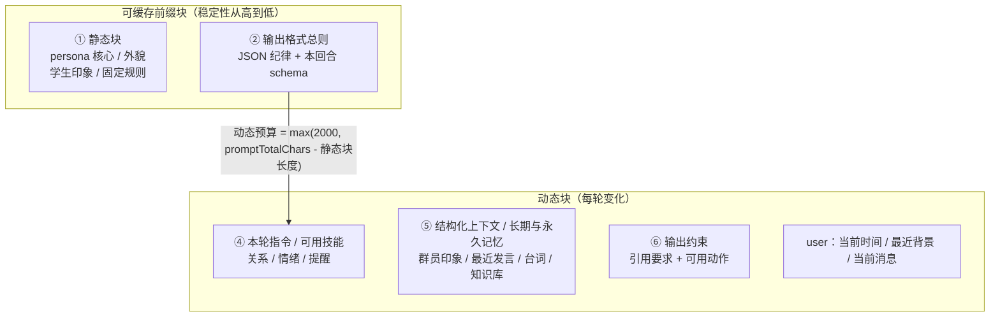
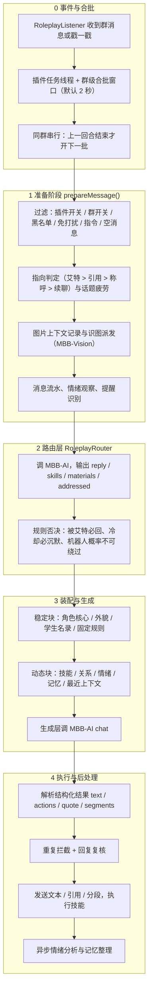
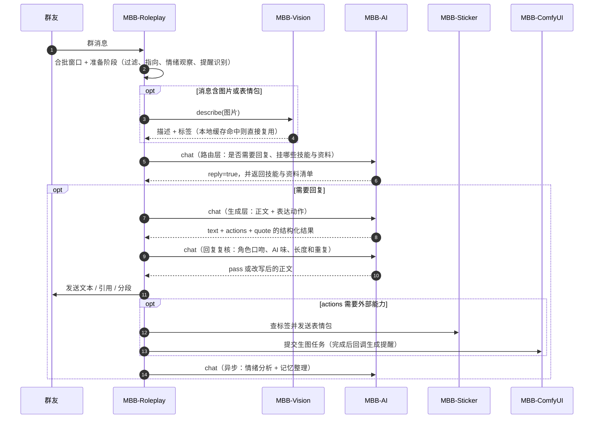

# MBB-Roleplay 回复架构

## 提示词结构与缓存

系统提示词按「可缓存前缀在前、逐轮动态在后」拼装，目的是让服务端的提示词前缀缓存尽量命中。
一次回复通常发给模型两条消息，命中 `speechPatterns` 时会额外插入一条仅含本轮语气规则的 system 消息：

- `system`：缓存前缀块 + 动态块，见下面的两张表。
- `user`：当前发言者、当前关系、当前消息指向、当前消息或合批文本、最近群聊上下文；带图片上下文时再追加图片本体。

当前时间也放在 `user` 消息开头，不再进入 system 动态块。可人工审阅和修改的完整提示词模板维护在
`D:\CodeX\Projects\MBB-Persona\prompts\mbb-roleplay-system.md`；MaiBot 对照分析见
[MaiBot 提示词与拟人化对照](maibot-reference.md)。

稳定规则、工具协议、动态指令、关系情绪、当前用户消息、私聊和回复复核提示词都按功能分区换行，
使用 `【身份关系】【回复长度】【工具装载】【本轮资料】【当前消息】` 等小节。分区只调整提示词结构，
不改变缓存顺序。回复长度只约束单条上限，不设置最低字数。

### 缓存前缀块（按稳定性从高到低）

| 顺序 | 资料 id | 内容 | 变更时机 | 单项字符上限 |
|---|---|---|---|---|
| 1 | `persona.core` | 角色核心设定 | persona、知识库或配置变化 | 6000 |
| 2 | `persona.appearance` | 角色自己的外貌 | 同上 | 1200 |
| 3 | `students.brief` | 了解的学生（一句话印象） | 同上 | 4000 |
| 4 | — | 固定规则（关系、隐私、风格、输出纪律等） | 同上 | 约 1950 |
| 5 | — | 输出格式总则 + 本回合 schema | 合批回合与单回合不同，其余稳定 | 约 400 |

前缀块的特点：

- 各自只受单项上限约束，不参与 `promptTotalChars` 竞争。
- 必须连续排列，中间不能插入任何逐轮变化的内容，否则前缀缓存会从断点处截断。
- 短期记忆每 `memoryUpdateMessages`（默认 50）条消息变化一次，仍按动态资料处理，避免把会周期性变化的完整摘要放进稳定前缀。

### 动态块（每轮变化）

| 顺序 | 资料 id | 内容 | 是否常驻 | 优先级 | 单项字符上限 |
|---|---|---|---|---|---|
| 7 | — | 本轮指令（botOwner、另一个机器人、戳一戳、分段、合批） | 常驻 | — | — |
| 8 | — | 可用技能片段（按路由开放的动作） | 视路由 | — | — |
| 9 | — | 当前时间 + 当前发言者关系 | 常驻 | — | — |
| 10 | — | 情绪与关系（群级情绪、好感、信任、厌烦、情绪原因） | 常驻 | — | — |
| 11 | — | 待触发提醒（仅开放 reminder 技能时） | 视路由 | — | — |
| 12 | `member.profile` | 当前发言者的群员印象 | 常驻 | 91 | 600 |
| 13 | `context.recent` | 你最近说过的话 | 常驻 | 89 | 2500 |
| 14 | `context.otherRoleRecent` | 另一个角色机器人最近说过的话 | 常驻 | 87 | 1400 |
| 15 | `context.structured` | 当前群话题、背景、进展、待办和约定 | 记忆整理或每日复盘后更新 | 86 | `structuredContextMaxChars` |
| 16 | `memory.short` | 跨群短期记忆 | 每 `memoryUpdateMessages` 条消息更新 | 85 | 3000 |
| 17 | `tool.memory` | 最近工具结果摘要 | 常驻 | 83 | 按配置 |
| 18 | `memory.long` | 长期记忆 | 常驻 | 81 | 按配置 |
| 19 | `memory.global` | 全局永久记忆 | 常驻 | 79 | 按配置 |
| 20 | `expression.approved` | 已通过复核的群内表达候选 | 常驻 | 76 | 按配置 |
| 21 | `speech.corpus` | 台词示例 | 常驻 | 60 | 1300 |
| 22 | `students.detail` | 被提到学生的详细设定 | 仅未启用学生知识库时 | 80 | 4000 |
| 23 | `kb.<库名>` | 知识库命中条目 | 常驻候选，按相关性装配 | 按库配置 | 按库配置 |
| 24 | — | 输出约束（引用要求 + 可用动作） | 常驻 | — | — |

第 15、16、18、19 项要特别注意：结构化上下文只描述当前群，短期记忆负责跨群滚动背景，长期记忆和永久记忆默认按当前消息重新排序和筛选，所以它们**每轮都可能在变**，不能放进前缀块。主动发言反馈摘要（最近是否有人接话）作为固定逻辑拼接进动态指令区，不占用资料预算；注意力漂移摘要（当前群注意力高低）也作为固定逻辑拼接；每日复盘在凌晨 4 点更新短期记忆和结构化上下文。表达候选只有管理员 `/role expression promote` 或 `auto` 审核通过后才会作为 `expression.approved` 注入，拒绝和待审候选不会进入提示词；通过候选会异步生成 embedding，回复时用当前消息做向量与文本混合检索，embedding 不可用时回退原文本顺序。第 22 项只在知识库学生档案库未启用时注册，避免和 `kb.ba.students` 重复注入。

### 预算与拼装顺序



拼装规则：

1. 缓存前缀块各自只受单项上限约束，不参与 `promptTotalChars` 竞争；它必须连续排列，中间不能插入逐轮变化的内容。
2. 动态资料的预算是 `max(2000, promptTotalChars - 静态块长度)`，下限 2000 字符，避免静态块把动态资料挤没；输出格式总则不占用这份预算。
3. 动态资料按优先级从高到低填充，单份资料先按自己的单项上限截断，再受剩余总预算约束，填满即停止。
4. 常驻资料一定参与竞争；可选资料只有在路由层点名对应 id 时才参与，支持 `id:参数` 形式，例如 `students.detail:角色名`。
5. 第 7~11 项和第 20 项由固定逻辑拼接，不参与 `RoleplayMaterialBudget`；只有第 12~19 项的资料走资料预算分配。

全插件的 AI 提示词都按这个原则核对过一遍：

| 调用 | 结构 | 说明 |
|---|---|---|
| 回复层 | 缓存前缀块 → 动态块 → 输出约束 | 静态资料、固定规则和输出格式连续前置；时间进入当前 user 消息 |
| 路由层 | 角色/技能/资料 → 判断规则 → 输出格式 → 对话状态 | 已重排，把「对话状态」移到末尾 |
| 记忆整理 | 角色/规则 → 已有短期记忆 | 本来就正确，动态部分在末尾 |
| 长期/永久记忆合并 | system 放规则，user 放批次数据 | 本来就正确 |
| 回复复核与风格后处理 | `RoleplayReplyReviewService` | 复核层统一处理角色口吻、AI 味、链接、长句简写、换行和分句 |
| 提醒确认/到点提醒 | 角色设定 → 规则 → 时间与任务 | 本来就正确，动态部分在末尾 |
| 情绪分析 | 角色/性格 → 动态信息 → 判断原则 | 结构上同类，但整条只有约 600 token，低于服务商的最小缓存粒度，重排没有收益，暂不动 |
| 提醒识别 | 「你是定时提醒识别器。当前时间：…」+ 规则 | 动态时间在最前，但整条约 250 token，同样低于缓存粒度，暂不动 |

### 调用点观测

Roleplay 的 AI 请求会带两个观测字段：

- `taskName`：固定调用点标识，例如 `roleplay.reply`、`roleplay.router`、
  `roleplay.reply.review`、`roleplay.private.reply`、`roleplay.memory.update`。
- `promptVersion`：提示词模板版本指纹。主回复对静态资料、固定规则、工具协议和
  输出格式的稳定段做哈希；辅助任务对提示词构建类做字节指纹，避免时间、情绪、
  记忆和当前消息等动态内容让版本每轮变化。

`MBB-AI` 会按调用点和版本分别累计请求、Token、耗时、缓存命中和成功率，
`/ai usage` 图片可以直接看出低缓存调用点，以及修改 Prompt 前后的效果差异。
请求快照与重放暂不落库，留到后续 UI 阶段处理。

## 分层处理



回复流程分成四段，详细设计见 [DESIGN-LAYERED-AI.md](../../MBB-Roleplay/DESIGN-LAYERED-AI.md)。

路由层和生成层都会收到结构化的发言指向信息：发送者、艾特目标、引用目标以及是否指向角色。判断顺序固定为「艾特目标 > 引用目标 > 开头称呼 > 最近对话对象 > 话题延续」，仅在句子里提到某个名字不会被当成直接对该名字说话。这样多人同时发言、引用别人或提到第三个人时，角色不会把这些消息都误判成对自己说。

最近群聊上下文会标记 `[自己]`、`[其他角色机器人]`、`[群友]`。其中 `[自己]` 是角色之前发送过的内容，`[其他角色机器人]` 是另一个机器人，避免模型把自己的旧发言或同伴发言误认成群友发言。

话题疲劳按群写入 SQLite。路由层会收到当前话题在时间窗口内的出现次数和角色自己参与次数；同一话题反复出现时，没有新信息、没有直接点名或引用的消息会降权或跳过，避免角色围绕一个旧细节反复接话。

**本地回复意愿门控**：AI 路由之前会先计算一个本地意愿概率，特征包括是否直接点名/引用、
是否指向其他成员、续聊、兴趣、群活跃、话题疲劳、纯媒体、近期消息量、角色自身发言占比和注意力。
默认 `replyWillingnessMode=shadow` 只写 `[角色] 群... 意愿` 日志与 trace，不影响回复；
只有切到 `enforce` 才会拦截低于阈值的低意愿消息，直接点名始终放行。这样可以先积累日志，
确认概率分布后再启用实际拦截。

**路由层**：每条群消息都会先过一遍路由，判断要不要回复、要挂哪些技能、要带哪些资料。
提示词刻意保持小，不带人设正文。规则保留否决权：被直接艾特必须回复，冷却中必须沉默，
路由层不能推翻。路由输出被 reasoning 截断时自动提高 Token 重试一次，仍失败则回退到规则决策，
不会因为路由出错而漏掉艾特。另一个角色机器人的消息仍受 `otherRoleBotReplyChance`
概率控制，AI 路由不能绕过机器人互聊概率。

```yaml
routerEnable: true
routerProfile: ""            #留空则使用 aiProfile
routerMaxTokens: 2400
routerReasoningEffort: "none"
```

**技能注册表**：技能按声明注册。`toolEnable=true` 时，当前注册的
`draw`、`reminder`、`memory`、`global-memory`、`sticker`、`poke-back` 会适配成原生工具，
模型统一通过 `tool_search` 和 `tools/tool_calls` 调用。旧的
`<reminder>` / `<remember>` / `<global_remember>` / `<sticker>` 标签仍然兼容，
会被转换成同一批技能调用。
`sticker` 默认属于首轮核心工具；当前或最近图片可复用时，`sticker_save` 会自动进入本轮工具集，
保存动作由 `MBB-Sticker` 公共 `add` 服务完成。

**资料预算**：角色核心、外貌、学生名录、学生详细设定、长期/全局/短期记忆、最近发言、
工具结果和台词示例各自独立成项，常驻项必带，其余按路由点名的 id 注入。默认关闭本地硬预算，
避免角色在搜索和多轮工具任务中被过早截断；需要限制时可显式开启。

```yaml
contextHardLimitEnable: false
promptTotalChars: 120000
```

即使关闭总硬预算，各类资料仍保留单项预算；工具结果另有单轮总字符预算。

**缓存前缀**：persona、通用规则、工具分类和输出格式放在系统消息最前面；
当前时间进入 user 消息，情绪、关系、工具结果和记忆排在稳定前缀之后；
最近群聊背景放在用户消息前半段，当前消息放在最后。单轮工具循环固定 `tools` schema，
`tool_search` 只扩充本地可执行工具集合，不再改变后续请求的工具定义前缀。

**回复复核与风格后处理**：独立 `RoleplayStyler` 已移除，去 AI 味、压缩简写、链接清理、
换行和分句统一进入 `RoleplayReplyReviewService`。单条回复和合批段落都会复核；单条最多使用
`replyBeatMaxSegments` 行，合批段落最多使用 `replyMaxSegments` 行。固定关系称呼如“妈妈”
必须原样保留，否则本地校验会丢弃改写结果。发送层仍保留链接过滤和最终拆分的本地兜底。
正常心情下句号会转换成换行节拍，只有烦躁、低落或闹别扭时允许保留。

```yaml
replyReviewEnable: true
replyReviewProfile: ""
replyReviewMinScore: 70
```




## 消息合批

群里刷屏时不再逐条排队，而是先做自适应防抖再攒批：

- 同一群的消息先进入合批窗口，默认使用 `natural` 档，按群活跃度、同一用户续发或换人动态计算等待；
  `messageBatchWindowSecond` 是单次等待上限，默认 2 秒
- 新消息到达会让旧定时任务失效并重新计算等待，但整批从第一条消息开始最多等
  `messageBatchMaxWaitSecond`（默认 8 秒），不会因为持续刷屏无限延后
- 被直接艾特或引用角色时使用不超过 1 秒的快路径；纯图片和纯表情包只给首包识别等待，
  后续同类媒体只并入批次，不再延长窗口
- 窗口结束后整批只做一次路由、一次生成；处理期间到达的消息进入下一批，
  等当前回合真正出声（含表情包等待结束）后立刻接手，不再额外等一个窗口
- 同一群同一时刻只有一个回合在跑，回复冷却的判定与时间戳写入加锁，避免并发回合同时通过冷却检查各回一次
- 一批最多合并 10 条消息，超出时优先丢掉最早的非点名消息，被艾特或引用角色的消息优先保留
- 等待超过 `messageBatchMaxAgeSecond`（默认 20 秒）且没有被点名的消息直接丢弃，避免回复一分钟前已经翻篇的话题
- 合批回合允许模型返回多段回复，每段用 `to` 指向批内某一条消息，可以分别回应不同的人
- 合批回合最多回复 `batchMaxSegments` 段，默认 4 段；单条消息仍按原来的最多 2 段拆分
- 段内换行和单回合一样会拆成多条消息发送，引用只挂在第一条上；整批最多发 `batchMaxSegments` 的两倍条数，避免刷屏
- `to` 越界、或者指向的消息与主消息不是同一个人时，该段降级为不引用，正文照常发送
- 批内消息会带上到达时间，提示词要求只回应批内列出的消息，最近群聊仅作为背景
- 关闭 `messageBatchEnable` 可以退回一条消息一个回合的旧行为；
  `messageBatchDebounceMode` 设为 `off` 时仍合批，但不等待，立即刷新当前批

表情包等待同样改成了事件驱动：用户补发的表情包识别完成后立即合并，同一用户又发了新消息也会立刻结束等待，
只有这两种情况都没出现时才等到 `stickerAttachWindowSecond`；识别已经开始时最多再等 `stickerAttachMaxWaitSecond` 秒。

## 结构化输出

执行层按约定返回结构化结果，正文和表达动作在同一次生成里决定：

```json
{"text":"戳你哦！","actions":[{"type":"poke_back"}],"quote":true}
```

合批回合返回多段时改用 `segments`，每一段可以引用批内不同的原消息：

```json
{"segments":[{"text":"这句回你","to":2,"quote":true,"actions":[]},{"text":"那句回他","to":5,"quote":false,"actions":[]}]}
```

`to` 是批内消息序号（从 1 开始），越界或省略时回退到本轮主消息；每段的 `actions` 独立校验，
单段失败只丢弃该段，不影响其他段。

`actions` 只能从本轮开放的动作里选，未开放的动作会被丢弃。解析失败时退化为「整段内容
当正文、不带任何动作」，不会因为格式问题丢掉回复。

解析器会先尝试严格 JSON，再修复常见键名损坏和全角标点混用，例如模型输出 `{:text":"正文"}`、
中文引号 `“text”`、全角冒号或全角分隔逗号时会尝试恢复成标准结构；字符串内部的中文标点会保留。
缺少右花括号等情况还会走宽松字段提取。只有内容看起来就是结构化结果、但正文又无法提取时才跳过发送，
不会把 JSON 外壳原样发到群里。修复成功会在控制台输出诊断日志。

动作发出前还会校验冷却与目标，
校验失败只丢弃该动作，正文照常发送。


## 重复回复拦截

代码层重复回复兜底默认关闭（`repeatSuppressEnable: false`），重复问题先由提示词约束。
开启兜底后，生成回复会跟最近的角色回复做两道比对，命中就整条丢弃：

1. **字面相似度**：bigram Dice 达到 `repeatSimilarityThreshold`（默认 0.72）
2. **长公共片段**：最长公共子串达到 `repeatCommonRunMinChars`（默认 8 字）

第 2 条是为“同一组信息换个尾巴”的复读准备的。实测“布丁明早验，咖喱七点，别糊锅”和“布丁明早验，咖喱七点，再不睡就凉了”的 bigram 相似度只有 0.516，够不着 0.72；
但两者的公共片段有 9 个字，会被第 2 条拦下。同一开头重复和“嗯”开头另有 `repeatOpeningLimit` 限制。

