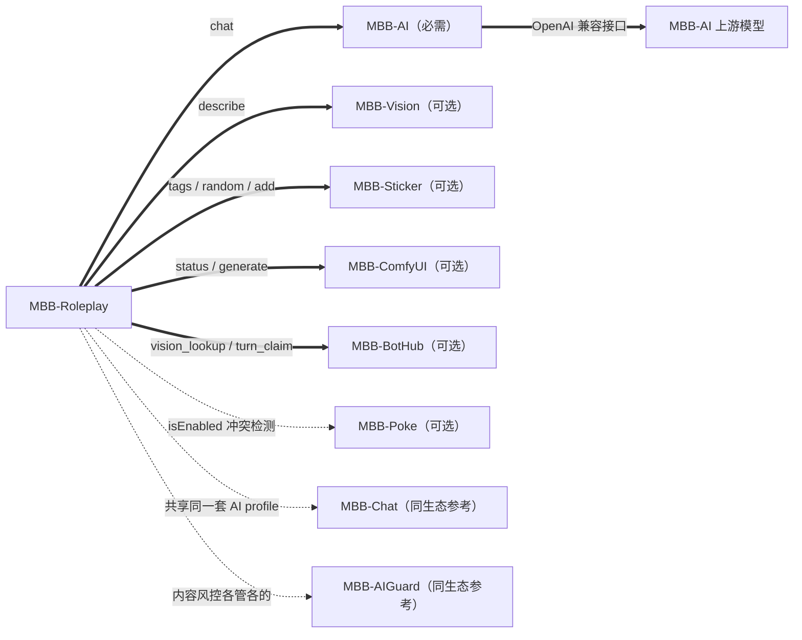

# MBB-Roleplay 技能与集成

## 插件协作总览

Roleplay 是「角色层」，模型、识图、表情包、生图分别由同仓库的其他插件提供。下面这张图可以直接当作插件间集成的参考示例：粗实线是运行时真实调用，虚线是状态检测或生态内约定。



| 调用方 | 服务名 | 动作 | 用途 | 缺失时的行为 |
|---|---|---|---|---|
| 路由层 | `MBB-AI` | `chat` | 判断是否回复、挂哪些技能与资料 | 回退到规则决策 |
| 生成层 / 回复复核 | `MBB-AI` | `chat` + `tools/tool_calls` | 按需加载工具、生成正文、复核角色口吻 | 不回复 / 直接用原文 |
| 记忆整理 | `MBB-AI` | `chat` | 短期、长期、永久记忆提取与合并 | 整批失败即放弃，保留原数据 |
| 情绪分析 | `MBB-AI` | `chat` | 心情、好感、信任、厌烦与群员个人记忆 | 跳过本轮情绪更新 |
| 提醒识别 / 到点提醒 | `MBB-AI` | `chat` | 解析提醒时间、生成提醒正文 | 安静忽略，不创建任务 |
| 识图 | `MBB-Vision` | `describe` | 图片与表情包描述、标签与本地缓存 | 图片消息不注入描述 |
| 表情包 | `MBB-Sticker` | 查询标签 / 随机发送 / 导入 | 角色通过首轮开放的 `sticker` 发送，必要时用 `sticker_save` 主动收藏当前或最近图片 | `sticker` 与 `sticker_save` 工具不开放 |
| 生图 | `MBB-ComfyUI` | `status` / `generate` | 角色通过原生 `draw` 工具生图，包含群级冷却与完成回调 | `draw` 工具不开放 |
| 多机器人协作 | `MBB-BotHub` | `vision_lookup` / `vision_claim` / `vision_publish` / `vision_wait` / `turn_claim` / `task_claim` / `chat_guard` | 同群多 bot 共享识图、回合权、任务去重与互聊熔断 | 完全退回单机：识图各识别一次，回复不做跨进程去重 |
| 戳一戳 | `MBB-Poke` | `isEnabled` | 检测冲突，避免同一件事回两次 | Roleplay 自行处理戳一戳 |

集成约定：

1. 只通过 `getService("MBB-xxx")` 拿服务，不直接引用对方的实现类。
2. 调用参数和返回值都是 fastjson 的 `JSONObject`，用 `status` 字段判断成败。
3. 可选插件缺失时降级而不是报错：技能不开放、资料不注入，其余功能照常。
4. 多个 AI 插件同时启用时，共用 `MBB-AI` 的 `maxConcurrent`，需要按总并发量配置。

## 多机器人协作（MBB-BotHub）

同一个群部署多个角色机器人时，`MBB-BotHub` 负责跨进程协调两件事：共享识图和回合权。
它是可选插件，没装、没连上或被关掉时，Roleplay 完全退回单机行为。

共享识图的 key 是 `群号 + 消息ID + 片段序号`，两个 bot 收到同一条消息时算出同一把 key，
不依赖图片 URL、文件名或 `file_unique` 是否为空。流程是：

1. `vision_lookup` 命中共享缓存就直接复用，不调 `MBB-Vision`；
2. 未命中则 `vision_claim`，只有一个 bot 认领成功；
3. 认领成功的 bot 调 `MBB-Vision.describe` 后 `vision_publish`；
4. 认领失败的 bot 用 `vision_wait` 等广播，超时才回退本地识图，保证不丢描述。

回合权在路由判定「要回复」之后、发送之前认领：单条回合用 `m<消息ID>`，合批回合用
`b<批次最后一条消息ID>`。直接点名带 `priority`，可以接管已有租约，避免被别的 bot 抢先导致点名没回；
回复发送完成后释放租约，默认 60 秒过期。

相关配置：

```yaml
hubEnable: true
hubVisionShareEnable: true
hubVisionWaitMs: 15000
hubTurnShareEnable: true
hubTaskDedupEnable: true
hubChatGuardEnable: true
hubTypingBroadcastEnable: true
```

除了共享识图和回合权，Roleplay 还通过 hub 做两件事：

- **任务去重**：提醒创建前用 `reminder|群|用户|时间|目标|内容` 认领一次，两个 bot 只会有一个真正建库并发确认。
- **互聊熔断**：判定消息来自另一个角色机器人时先过 `chat_guard`，同群连续 bot-to-bot 轮数超限就一起停，真人发言后清零。

回合权不再先到先得，而是带分数认领：被点名 100 / 被引用 80 / 延续自己参与的线程 60 / 泛群聊插话 40，
同分用 `botID` 稳定哈希决定，两个进程算出的结果一致。低分先到会被高分抢占，生成完成、发送前
Roleplay 还会用 `turn_status` 复核一次，被抢就放弃发送。赢了之后会在生成前广播打字状态
（`typing start` / `typing stop`），让另一个角色知道这边正在生成；双方都被点名时第二个按
`multiReplyStaggerMs` 错峰回复。

部署与排查见 [MBB-BotHub 文档](../MBB-BotHub.md)。

## 生图 prompt 管线

生图不再由角色层直接写最终 booru prompt，而是拆成两段：

1. 角色层只输出结构化 `brief`：目标角色、主体、动作、表情、服装、场景、构图、尺寸、必须出现和禁止出现；
2. `RoleplayDrawPromptService` 用独立上下文把 `brief` 编译成最终 prompt，并按 `brief.characters/subject` 解析目标角色，注入对应角色的 `imageTags`、`imageNegativeTags`、外貌资料和知识库条目。

编译器只取目标角色自己的学生条目，不会把其他角色或同源角色的外貌一起注入。用户让角色画别人时，目标角色就是别人，不会自动把当前角色画进画面。编译完成后 `RoleplayDrawPromptValidator` 会做本地质检：把其他角色和冲突外貌词从正向 prompt 移到负向 prompt，强制目标角色 canonical tag 和人数标签。最终交给 `MBB-ComfyUI` 的是 `prompt + negativePrompt + size + camera`，其中 `negativePrompt` 会追加到 ComfyUI 全局负向词后面。

`MBB-ComfyUI` 生成完成后，如果 `identityCheckEnable` 为 `true`，会调用 `MBB-Vision` 对图片做一次身份/外貌校验：命中 `forbiddenTags` 时在控制台输出“身份校验疑似不符”，校验只记录日志，不阻断图片发送。

draw 工具成功只表示任务已提交。Roleplay 会在本轮最终回复阶段抑制额外正文，由 MBB-ComfyUI 在图片完成时
发送图片和完成提醒；回调同时携带生成文件路径，Roleplay 工作区启用时会自动归档到
`media/generated/comfyui/`。

## 回复复核与隐式反馈

主动发言反馈除了“窗口内有人接话”，还会把引用角色消息、戳一戳、表情回应作为隐式反馈。发送前 `RoleplayReplyReviewService` 会对回复候选做一次复核，低于 `replyReviewMinScore` 且模型给出改写时使用改写文本。

会话线程由 `RoleplayThreadService` 维护，线程提示会进入路由和回复提示词；拟人节奏由 `RoleplayPacingService` 控制；安全与防注入由 `RoleplaySafetyService` 在消息进入路由前和长期记忆写入前拦截。

## 戳一戳与引用

被人戳一戳时，插件走和群消息同一条处理链路，只是把当前消息换成「有人戳了你」。
角色可以只回一句话、只戳回去、两者都做，或者干脆不理会，由执行层自己判断。

```yaml
pokeReplyEnable: true       #是否响应戳一戳
pokeBackEnable: true        #是否允许戳回去
pokeReplyMaxChars: 20       #戳一戳回复单条短消息的最大字符数
pokeBackCooldownSecond: 60  #对同一用户戳回去的最小间隔
pokeStreakWindowSecond: 60  #连续戳一戳的统计窗口
pokeStreakThreshold: 3      #窗口内戳几次开始算骚扰
```

戳一戳的正文使用专用发送路径，只发送一条消息，不参与普通回复的两段拆分。模型返回较长内容时，插件会优先在句末或弱标点处截断到 `pokeReplyMaxChars`。

戳一戳默认是**主动互动的加分项**：单独戳一下只会小幅提升心情、好感和信任，不会涨厌烦。
只有在 `pokeStreakWindowSecond` 秒内被同一个人戳到 `pokeStreakThreshold` 次以上，才升级成骚扰事件，
开始涨厌烦并压低耐心；这一轮也不会再戳回去，角色会用一句短促的话让对方别戳，但不会辱骂或发火。

`MBB-Poke` 已经在处理戳一戳，所以本插件检测到它处于启用状态时会自动跳过戳一戳事件，
避免同一件事回两次。

角色手机相机由 `cameraEnable` 控制，默认开启。只想关闭自拍和拍照而保留普通生图时，把它设为 `false`，再执行 `/role reload` 或重启主程序：

```yaml
cameraEnable: false
```

群友用引用回复时，插件会把被引用的那条消息解析成 `[引用 某人：内容]` 前缀，跟在对方这次说的话前面一起交给模型，
否则角色只看到新消息、看不到对方在回应什么。解析顺序是先查本地消息流水（插件自己记录过的群消息），
查不到再调一次 OneBot 的 `get_msg`；两者都拿不到就退回普通消息。被引用内容截断到 60 字，避免长文撑爆上下文。

被艾特或被直接回复时，插件会引用原消息：

```yaml
quoteReplyEnable: true   #回复被艾特或被直接回复的消息时是否引用原消息
```

引用由规则强制，模型可以额外建议引用，但无法取消规则要求的引用。


## 自然语言提醒

角色会调用 AI 识别提醒意图和时间，并把任务写入 SQLite，重启后仍会恢复。识别失败时安静忽略，不再回退到内置时间规则，也不会再发“没有识别出具体时间”的提示：

```text
下午三点提醒我干活
明天早上八点提醒我开会
10分钟后提醒我喝水
晚上八点叫我交作业
```

到点后会调用角色 AI，按当前人设生成提醒正文，再主动发送：

```text
@用户 该干活了
```

AI 不可用或返回空内容时，会回退到固定模板。创建时保存的角色关系和任务信息也会一起提供给 AI。

控制台会输出：

```text
[提醒] AI识别成功 群xxx 用户xxx 时间=2026-10-04 15:00 内容=干活
[提醒] AI确认生成 #12 群xxx 用户xxx 内容=好，下午三点我会提醒你干活~
[提醒] 创建 #12 群xxx 用户xxx 时间=2026-10-04 15:00 内容=干活 识别=AI
[提醒] 触发 #12 群xxx 用户xxx 内容=干活
[提醒] AI生成 #12 群xxx 用户xxx 内容=该干活了
[提醒] 发送成功 #12 群xxx 用户xxx
```

`reminderEnable` 控制是否启用，`reminderAiParse` 控制是否使用 AI 识别（关闭时改用内置规则解析），`reminderMaxDays` 控制最长提前天数，默认 30 天。

提醒消息会携带不可见标记。其他角色机器人识别到该标记时会跳过，避免两个角色互相抢答，但 QQ 消息中不会出现固定文字前缀。角色名识别只使用配置的 `otherRoleBotNames`，默认不内置具体作品角色名。

用户还可以通过 `/reminder` 管理自己的任务：

```text
/reminder list
/reminder show 12
/reminder edit 12 明天早上八点 开会
/reminder delete 12
/reminder clear
```

用户只能查看和修改自己在当前群的提醒；编辑会重新排期，旧定时器不会提前触发。

自我提醒会保存原始上下文，并在到点生成时明确“这是角色自己该做的事”，避免把角色自己的待办误写成提醒用户。


## 训练语料采集

对着任意一条群消息回复 `/role learn [备注]`，就会把那条消息和前后文一起存成一条训练样本。
目标消息不限于角色自己发的，群员发的也可以采集——这样既能攒「角色该怎么说话」的正样本，
也能攒「这种语境下该接什么」的样本。

```text
/role learn                     不带引用时采集最近一条群消息
/role learn 这条很像绿的口气     采集时附带备注
/role learn stats               查看累计采集数量
/role learn recent 5            查看最近 5 条记录
```

产物在插件数据目录：

```text
train-corpus/learned.jsonl
```

一行一条记录，字段是后续 SFT 直接能用的 `(上下文 → 目标消息)` 结构：

```json
{"id":"learn-20261019-015000-1234","role":"才羽绿","personaFile":"persona-midori.json",
 "groupID":974272471,
 "target":{"messageID":123,"userID":640562581,"userName":"老师","isBot":false,
           "time":"2026-10-19 01:49:00","text":"小绿今天好可爱"},
 "contextBefore":[{...}],"contextAfter":[{...}],
 "note":"这句像绿的口气","learnedBy":640562581,"learnedAt":1792345000000}
```

用 JSONL 而不是缩进 JSON，是因为这个文件要直接喂给后续的微调流程，追加写入也不怕中途中断；
想快速复核内容用 `/role learn recent` 就行。

相关配置：

```yaml
learnEnable: true
learnDirectory: "train-corpus"
learnContextBefore: 6
learnContextAfter: 3
```

命令在消息进入合批与路由之前拦截，所以采集用的 `/role learn` 本身不会触发角色回复。
权限为 owner 或 bot 管理员。

## 本地小模型实验与训练

`MBB-Model` 是一个独立部署的本地小模型服务（默认 Qwen3-1.7B）。本地风格层暂未接入回复主链路，
当前保留推理与训练接口，用于后续单独评估。路由、决策、技能、记忆和发送前复核仍走主模型链路。

Roleplay 通过 HTTP 调它，地址由 `modelServiceUrl` 配置（默认 `http://127.0.0.1:8770`）：

```text
/role train                 查看模型服务与训练状态
/role train corpus [条数]   用上次截止到现在的新消息继续训练当前 adapter
/role train fresh [条数]    从最早群消息开始，从底座新开 adapter
/role train learn           用 /role learn 采集的特挑语料训练
/role train cutoff [时间]   查看 / 设置 / 重置训练截止时间
/role train reload          让 MBB-Model 重新加载 adapter
```

**群聊语料怎么取**：直接读本地消息表 `plugin_mbb_roleplay_messages`，按
`(前 N 条群聊记录 → 这一条)` 切成 ShareGPT 样本。默认只取真人发言
（`trainIncludeBotMessages=false`），跳过命令消息和超过 `trainMaxChars` 的长文。
图片、表情包、语音、视频和文件占位符不会作为训练目标，上下文里的同类标记也会被剥离，
避免风格模型学会输出 `[图片]`。

**不重复喂老数据**：每次训练把「已处理到的行号 + 对应时间」写进插件存储
（`trainCutoffRowID` / `trainCutoffText`）。下次 `/role train corpus` 只取这之后的新消息，
所以可以反复执行，不用手工记位置。`/role train cutoff reset` 会退回从头开始。

**adapter 续训与备份**：默认训练会读取 `MBB-Model` 的 `adapters/current.json`，
把当前 adapter 完整复制到本次任务的新目录，再在副本上继续训练；旧目录不会被修改。
`/role train fresh` 不加载旧 adapter，而是从底座重新初始化一个 LoRA，并从最早群消息开始取样本。
两条链每次都使用新的 `adapters/<jobId>/`，因此历史 adapter 都保留可回退。

**提交与训练是分开的两步**：先 `POST /train/dataset` 落盘，再 `POST /train/start` 排队；
`trainAutoStart=true` 时 bot 会自动接着启动训练，一条指令就能跑完。
只有数据提交成功才会推进截止游标，提交失败不会丢数据。

**进度与回报**：训练启动后 bot 每 10 秒轮询一次 `/train/status`，
任务完成或失败时会主动在发起训练的群里回一条结果（样本数、步数、最终 loss、耗时、adapter 路径），
最长跟踪两小时。中途也可以随时 `/role train` 看当前进度。
服务端控制台会同步打印每个阶段，注意 `4% 加载依赖库` 到 `8% 加载 tokenizer` 之间
是在 import torch/transformers，显卡空闲是正常的，真正占用显存从 `25% 加载底座模型` 开始。

相关配置：

```yaml
modelServiceUrl: "http://127.0.0.1:8770"
modelServiceToken: ""
modelServiceTimeoutSecond: 120
trainEnable: true
trainContextBefore: 4
trainMaxSamplesPerRun: 2000
trainMaxChars: 200
trainIncludeBotMessages: false
trainAutoStart: true
```

服务端的部署与接口见 `MBB-Model` 项目自己的 README 和 `docs/API.md`。

## 台词语料检索

语料文件放在插件数据目录：

```text
speech-corpus/speech-corpus-<persona>-qq.jsonl
speech-corpus/speech-corpus-<persona>.jsonl
```

语料统一在 `MBB-Persona` 私有仓库的 `corpus/` 中维护。把需要的语料复制到上述 `speech-corpus/` 目录后执行 `/role speech reload`；插件不再内置完整语料。
`-qq.jsonl` 放人工整理的群聊语气样本，检索时获得更高权重；普通文件通常是原作剧情台词，只作保底。

每行一个 JSON 对象：

```json
{"id":"example-000001","role":"example","text":"示例台词","tags":["日常","任务"],"emotion":"curious","scene":"group_chat","register":"qq","source":"manual-qq-style","weight":1.0,"spoiler":0}
```

插件会使用当前消息和最近群聊上下文做本地字符 n-gram 检索，把少量参考台词注入角色提示词。参考示例只用于学习表达方式，生成后还会做相似度检测，避免直接照抄台词。

检索除了字面相似度，还会用到语料自带的元信息：

1. **情绪加成**：角色当前厌烦偏高或耐心偏低时偏好 `annoyed`/`serious`，心情好时偏好 `happy`/`excited`/`proud`，心情低时偏好 `sad`/`serious`。情绪只在明显偏离基线时才参与，因为语料里 `neutral` 占了四分之三。
2. **场景加成**：直接点名或引用回复偏好 `reply`，戳一戳偏好 `group_chat`，其余走 `daily`。
3. **同一出处只取一条**：避免整批示例来自同一段剧情，语气高度雷同。
4. **剧透过滤**：`spoiler` 超过 `speechSpoilerLevel` 的台词直接不参与检索，默认只排除严重剧透。
5. **参考示例不沿用话题**：台词语料只用于参考语气和表达方式，提示词会明确要求不要沿用示例里的具体话题、职业内容或项目进度。
6. **群聊样本优先**：`register=qq` 或从 `-qq.jsonl` 加载的条目权重更高。默认每次最多只注入 2 条，避免多段剧情台词把模型带回舞台腔。

情绪与场景是加成而不是过滤条件：语料里 neutral 占大多数，硬过滤会把可用台词砍掉大半，加成只影响同类候选之间的排序。

相关配置：

```yaml
speechCorpusEnable: true
speechCorpusDirectory: "speech-corpus"
speechRetrievalCount: 2
speechRetrievalMaxChars: 1200
speechRetrievalMinScore: 0.35
speechSpoilerLevel: 1
speechSimilarityThreshold: 0.78
speechSimilarityMinChars: 6
```

## 可选知识库

知识库用来回答事实类问题，人设、口癖和关系仍然由 persona 负责。格式标准见 [KNOWLEDGE.md](../../MBB-Roleplay/KNOWLEDGE.md)。

推荐直接安装公开知识库：

[MossCG/MBB-Knowledge](https://github.com/MossCG/MBB-Knowledge)

安装步骤：

1. 克隆或下载知识库仓库。
2. 把仓库里的 `knowledge/` 目录复制到运行目录：

```text
./MoBoxBot/plugins/MBB-Roleplay/knowledge/
```

3. 在群里执行：

```text
/role kb reload
/role kb list
```

目录结构：

```text
knowledge/
├─ <library>/
│  ├─ _index.md
│  └─ example.md
└─ REPORT.md
```

每个条目一个 md 文件，文件头写 `id`、`name`、`summary` 等元信息，正文按 `##` 小节切分。插件启动时建立小节级索引，检索时先按 `name` 和 `aliases` 锁定实体，再按字符 n-gram 打分取小节，只注入命中的摘要和小节，不注入整篇档案。命中实体时只保留被锁定的条目，避免把 A 角色的属性套到 B 角色身上。

知识库由路由层按需点选，不是每条消息都注入；单条、单库和提示词总量三层预算同时生效。命中的库、条目数、小节数和占用字符会打印在控制台日志里。

`knowledgeStudentsLibrary` 指向学生档案库的库名（默认 `ba.students`）。这个库启用后，插件会**停用自带的学生详细设定资料**：
`students.json` 里的 69 人只有外貌，而知识库的学生条目覆盖 153 人并且含性格、关系、梗与剧情，
两者同时存在会让同一份学生信息被注入两次。停用后路由层不再推荐 `students.detail`，问起学生时统一由知识库回答。
把这一项留空，或者知识库里没有该库，就会退回原来的自带名录，不会丢功能。

同一个开关还会接管另外两处学生资料：

1. **识图参考**：传给 `MBB-Vision` 的学生外貌参考改为从知识库条目的「外貌」小节生成，
   总预算 `visionReferenceMaxChars`（默认 `32000`）按学生数平均分配，保证 153 人都能进候选列表，
   不会因为截断丢掉后半批。实测约 2.8 万字，比原来 69 人的自带图鉴（约 3.9 万字）更小且覆盖更全。
   换参考文本会改变 `MBB-Vision` 的缓存键，所以升级后第一次识图会重新识别一次。
2. **一句话印象**：角色「了解的学生」那 9 条印象改为从知识库条目的 `summary` 取，
   避免人设里写死的印象和知识库说法不一致；名字匹配不上时保留人设原文。

首次启动时插件会在 `knowledge/` 下释放一个 `example/` 示例库（`enabled: false`，不参与检索），
用来演示目录与文件格式。这个示例只在知识库目录第一次创建时写入，**直接删掉 `example/` 后不会在重启时被补回来**；
只有把整个 `knowledge/` 目录删掉，插件才会重新释放一份示例。

```text
/role kb list                查看已加载的库、条目数、小节数与目录
/role kb reload              改完文件后重建索引，不用重启进程
/role kb search <文本>        查看命中的条目、小节和分数
/role kb on | off            开关知识库
```

相关配置：

```yaml
knowledgeEnable: true
knowledgeDirectory: "knowledge"
knowledgeStudentsLibrary: "ba.students"
knowledgeMaxEntries: 4
knowledgeMaxSectionsPerEntry: 2
knowledgeMinScore: 1.0
knowledgeInjectMaxChars: 2000
knowledgeSpoilerLevel: 0
```

角色 AI 可以在普通回复末尾输出结构化标记来主动创建任务：

```text
好，那我们玩到八点<reminder>{"time":"2026-10-04 20:00:00","task":"玩游戏到八点","target":"self"}</reminder>
```

标记及其内容不会发送到 QQ。`target` 为 `self` 时是角色自己的提醒，为 `user` 时提醒当前群友。到点后仍然会调用角色 AI 生成正文，并通过消息段艾特对应用户。

角色也可以直接查询、修改和删除当前用户在当前群的提醒：

```text
<reminder>{"action":"list"}</reminder>
<reminder>{"action":"delete","id":12}</reminder>
<reminder>{"action":"edit","id":12,"time":"2026-10-05 08:00:00","task":"开会"}</reminder>
```

角色提示词里会带当前用户的待触发提醒，但**分两种粒度**：只有对方确实在问提醒安排（消息里出现“提醒 / 几点 / 什么时候 / 安排 / 记了”）时才给完整清单，
其他情况只给“共几条 + 最近一条”，并附带一句“只是背景资料，不要在回复里逐条复述时间与内容”。
这样既能回答“我有哪些提醒”，又不会在普通闲聊里把待办当成素材念一遍。

