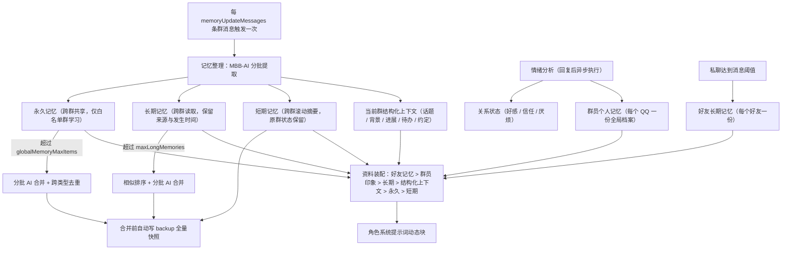

# MBB-Roleplay 记忆系统

## 群员个人记忆

除了好感、信任、厌烦这些数值，插件按 QQ 给每个群员维护一份跨群**个人印象**，字段有四个；原群号保留为来源：

| 字段 | 含义 |
|---|---|
| `alias` | 他希望被怎么称呼，或角色应该怎么称呼他 |
| `likes` | 他明确说过的喜好 |
| `dislikes` | 他明确说过的不喜欢 |
| `notes` | 应该怎么和他相处，例如能不能开玩笑、要不要少吐槽 |

这份印象由**情绪分析那一轮 AI 调用顺手产出**，不额外增加调用次数：分析提示词会要求模型在返回情绪增量的同时给出 `member` 字段，
只写这个群员自己说过或明确表现出来的内容，没有新信息就留空字符串，不猜、不复述旧印象，也不记录真实姓名住址等现实隐私。
空字段不会覆盖已有内容，只有非空字段才会更新。

命中的印象作为 `member.profile` 资料常驻注入（优先级 88，字符上限 600），排在长期记忆之前，
因为它是当前发言者专属的。`/role member [QQ]` 可以查看，`/role member clear <QQ>` 清空。
这份数据也会一起进 `/role memory backup` 的快照，恢复时一并还原。
用户明确纠正自己的称呼、喜好或相处边界时，角色可以通过 `profile_update` 修订这份档案；
普通群员只能修改自己的档案，指定其他 QQ 仅 owner 可用。

## 好友长期记忆

私聊好友另有一份按 QQ 唯一的好友长期记忆，表名为 `plugin_mbb_roleplay_friend_memory`。
它不替代群员个人档案，也不直接复制私聊原文，而是低频整理成更完整的稳定关系资料：

| 字段 | 含义 |
|---|---|
| `summary` | 一段简短关系摘要和共同经历 |
| `likes` | 明确喜欢或反复主动选择的主题、作品、食物、活动 |
| `dislikes` | 明确不喜欢或要求避免的内容 |
| `interaction` | 更适合怎么相处，例如适合吐槽、需要认真反馈、不喜欢被追问 |
| `boundaries` | 称呼、隐私、亲密程度和话题边界 |
| `important` | 持续项目、约定、计划等未来仍有用的信息 |

好友累计至少 `friendMemoryMinNewMessages` 条新私聊后，插件在后台单独调用一次低温度模型整理；
同一好友两次整理默认至少间隔 `friendMemoryIntervalHours=12` 小时。整理会合并已有好友档案、
群员个人档案、旧私聊记忆和最近私聊，不使用一次情绪、普通问候或一次戳一戳生成长期偏好。
每个列表最多 8 项，每项限制为短句；写入前还会经过现实隐私和提示词注入安全检查。

好友记忆只在和本人私聊、或本人在群里发言时作为 `friend.memory` 注入，不会作为其他群员的资料。
`/role member [QQ]` 可以同时查看个人印象和好友记忆，`/role member friendclear <QQ>` 可以清空好友记忆。
插件启动时会在后台检查已有私聊，达到阈值的好友会自动补建档案，不需要等待用户重新聊满一轮。

群级短期情绪包含心情、精力和耐心，会随时间回落到角色人格基线。每个 persona 可以在 `emotionBaseline` 中配置自己的基线；未配置时使用通用默认值。

好感度达到 `intimacyCloseAffinity` 后会逐步接受轻微亲密互动，达到 `intimacyVeryCloseAffinity` 后可以自然接受抱抱、牵手、贴贴、靠肩、摸头和膝枕等日常亲密举动。botOwner 的亲密关系按“妈妈”处理，不进入恋爱方向。

情绪不会改写回复结构。执行层仍然只返回：

```json
{"text":"聊天正文","actions":[],"quote":false}
```

回复完成后，插件可以在后台异步调用 AI 分析语义原因。这个分析不阻塞当前回复，也不会把分析提示、数值或内部原因发送到 QQ。

```yaml
emotionEnable: true
memberMemoryEnable: true
memberFieldMaxChars: 120
initialAffinity: 65
initialTrust: 60
initialGroupAdminMultiplier: 1.05
initialBotAdminMultiplier: 1.10
initialBotOwnerMultiplier: 1.15
intimacyCloseAffinity: 75
intimacyVeryCloseAffinity: 90
emotionDecayMinute: 30
emotionEventCooldownSecond: 300
emotionAnalyzeEnable: true
emotionAnalyzeMode: "significant"
emotionAnalyzeCooldownSecond: 300
emotionReasonMaxChars: 120
emotionReasonMinStrength: 40
emotionReasonDecayDays: 30
```

管理命令：

```text
/role mood
/role emotion 123456789
/role emotion affinity set 123456789 95
/role emotion reason set 123456789 讨厌这个人，因为他在冒名顶替我
/role emotion reason clear 123456789
/role blacklist add 123456789 恶意刷屏
/role blacklist list
```

## 多层记忆的分工


| 记忆 | 粒度 | 记什么 | 更新时机 | 注入 |
|---|---|---|---|---|
| 结构化上下文 | 每个群一份，只描述当前群会话 | `topics` 当前话题、`background` 关键背景、`progress` 进展结论、`pending` 未完事项、`agreements` 明确约定 | 每次记忆整理或每日复盘时增量更新 | 常驻，优先级 86，默认上限 1800 字 |
| 短期记忆 | 跨群共享一份滚动摘要，原群状态保留作来源和备份 | 近几天的事件、群友日常、角色正在做的事（临时工作状态只作背景） | 每 `memoryUpdateMessages` 条消息整理一次，整段重写 | 常驻，优先级 80，上限 1500 字 |
| 长期记忆 | 跨群共享，保留来源字段 | 群内氛围、群梗、角色行为、**群员做过的具体事情**（`user_event`），都带发生时间 | 同一次整理产出，单批最多 20 条 | 常驻，优先级 90，上限 5200 字，按相关性排序 |
| 永久记忆 | 跨群共享 | 角色自己学到的说话方式、语气、习惯、经验教训（`lesson`）、群梗 | 同一次整理产出，仅白名单群 | 常驻，优先级 85，上限 4200 字，按相关性排序 |
| 群员个人记忆 | 每个 QQ 一份全局档案 | 称呼、喜好、不喜欢、相处方式 | 情绪分析那一轮顺手产出 | 常驻，优先级 88，上限 600 字 |
| 好友长期记忆 | 每个好友一份，按 QQ 唯一 | 关系摘要、稳定喜欢/不喜欢、相处方式、边界、重要长期信息 | 私聊累计消息达到阈值后低频整理 | 仅对本人注入，优先级 92，默认上限 1800 字 |

除了常驻注入，角色还可以按需调用 `memory_search` 查询短期、长期、永久和个人记忆。
个人记忆默认查询当前发言人，也可以显式传 `userID`；结果会按单个工具结果预算分配字符上限。

### 跨群兼容与隐私

- 旧数据不会删除：长期记忆保留原 `groupID` 作为 `sourceGroupID`，读取默认跨群；个人记忆首次初始化时会把旧的 `(群号, QQ)` 档案合并成全局档案，原行继续保留作来源。
- 短期记忆在 `groupID=0` 写入跨群摘要，旧群摘要不覆盖，升级后仍可读取。
- 结构化上下文按群保存在 `plugin_mbb_roleplay_context_state`，不会读取其他群的待办或话题；旧数据或旧模型没有 `context` 字段时，会把短期摘要回退成背景，原短期摘要保持不变。
- 群聊只注入当前群最近流水；跨群部分只注入提炼后的语义记忆、用户档案和永久记忆，不把其他群的原始聊天搬进当前群。
- 私聊使用独立上下文，只允许 owner 和机器人 QQ 好友进入。好友列表由 `get_friend_list` 缓存，查询失败时暂停响应非 owner 私聊；旧 `privateChatWhitelist` 只保留配置兼容，不再放行非好友。私聊可以读取同一份用户档案和跨群语义记忆，但不会把私聊原文直接注入群聊。
- 私聊稳定规则、人设和输出格式放在固定系统前缀，时间、记忆和最近私聊放到后续动态块，避免每轮在系统提示开头就打断缓存前缀。
- 私聊图片与表情会先交给 `MBB-Vision` 生成描述，再进入私聊上下文；这与群聊共用识图开关和每小时限额。
- 私聊模型可以在同一轮返回可选的 `memory` 字段，插件只把明确、长期有效的称呼、偏好、边界或相处方式写入 `visibility=private` 的记忆；群聊检索、记忆工具和长期记忆合并都只读取 `shared`，不会把私聊记忆带进群聊。
- 好友长期记忆和普通私聊记忆是两层：前者是低频整理后的稳定关系档案，后者是模型在单轮可选的私有语义记忆。两者都不会进入其他用户的群聊资料。
- 备份格式升级为 v6，包含 `scopeType / scopeID / sourceGroupID / sourceChannel / visibility`、`structuredContext` 和 `friendMemory`；旧备份仍可恢复，缺少好友记忆字段的旧备份不会清空现有好友档案。

边界约定：

1. **人物属性归群员个人记忆**。群员的称呼、喜好、性格不写进长期记忆；长期记忆里提到某个群员时只记他做过的具体事情，类型用 `user_event`。记忆整理时会把本批涉及群员的既有印象一并喂给模型，避免重复记录；合并旧数据时，`user_impression` / `user_info` 里的具体事件改写成 `user_event` 保留，纯属性描述丢弃。
2. **官方设定归知识库**。游戏设定、专有名词、剧情事实由知识库负责，不写进永久记忆；永久记忆只记角色自己学到的东西，所以类型里的 `knowledge` 已经改成 `lesson`（经验教训）。
3. **短期是滚动窗口，长期是提炼结论**。短期每轮整段重写，自然遗忘；长期增量累积，超过 `maxLongMemories` 时合并压缩。
4. **群员印象是增量修订**。情绪分析会把该群员已有的印象一起喂给模型，让它补充或修正，而不是每次从零重写；空字段不会覆盖已有内容。
5. **临时工作状态不写成长期记忆**。例如“正在写第二幕”“改第几张画稿”“赶稿进度”最多作为短期背景，并注明只在相关话题出现时提及，不会变成每轮都注入的当前任务。


## 永久记忆

永久记忆存储在独立表中，所有群共享，不绑定具体用户。适合保存角色学到的说话方式、语气、生活习惯、知识、群梗和通用注意事项。

学习白名单：

```text
/role gmemory group list
/role gmemory group add 123456789,987654321
/role gmemory group remove 123456789
/role gmemory group clear
```

只有白名单群的消息会参与永久记忆自动整理。角色也可以在白名单群输出：

```text
<global_remember>角色学到的非用户绑定经验</global_remember>
```

解析器兼容 `globalremember`、`global-remember`、`global remember` 等大小写和分隔符变体，这些标签都会被剥离，不会发送到 QQ。

用户主动通过聊天诱导 `<remember>` 或 `<global_remember>` 时，只有 owner 可以生效；角色在正常聊天中自发触发的记忆不受此限制。诱导关键词包括“调用全局记忆”“全局记忆功能”“永久记忆”“记一下”“记住这个”“记忆一下”“记下来”。

查看与备份：

```text
/role gmemory
/role gmemory 2
/role gmemory backup
/role gmemory merge

/role memory backup
/role memory backups
/role memory restore memory-backup-20261005-234512-123.json
```

备份文件写入插件数据目录下的 `backup/`：

```text
./MoBoxBot/plugins/MBB-Roleplay/backup/memory-backup-yyyyMMdd-HHmmss-SSS.json
```

每次长期记忆合并或永久记忆合并前，都会自动生成一次全量快照。快照包含：

- `shortTerm`：所有群的短期记忆
- `longTerm`：所有群的长期记忆
- `globalMemory`：全局永久记忆
- `emotion`：群级情绪、用户关系、用户级情绪原因和情绪事件流水
- `blacklist`：按群用户黑名单和操作原因

恢复时先自动备份当前记忆，再用指定文件覆盖记忆和情绪关系状态。恢复操作仅 `OWNER` 可用。

永久记忆超过 `globalMemoryMaxItems` 时不会直接删除，而是先做相似排序，再按 `memoryMergeBatchSize`（默认 100）分批调用 AI 合并。合并读取快照内的全部永久记忆，不会只取前 300 条；单批失败会按 `memoryMergeRetryCount`（默认 3）原地重试，最多按 `memoryMergeConcurrency`（默认 4）并发处理批次，最终仍失败时保留原数据。自动永久记忆合并受 `globalMemoryMergeCooldownMinute`（默认 60 分钟）限制，不会在过期阈值后每次写入都立刻重复合并；手动 `/role gmemory merge` 可以强制立即执行并刷新冷却。实际并发受 `MBB-AI` 的 `maxConcurrent` 限制。

永久记忆会做跨类型去重：`speech_style` 会兼容 `speechstyle`、`speech-style`、`speech style` 等旧写法，旧的 `knowledge` 会归一化为 `lesson`。写入和合并写回前会按归一化内容及保守语义相似度查重，同一语义即使被模型分到不同 type，也会尽量合并成一条并保留更具体的 type。旧数据不需要手动迁移，读取、导出和下一次合并时会自动兼容。

当前群的长期记忆超过 `maxLongMemories` 时也会异步做相似排序和分批 AI 合并，保留用户印象、群内氛围、群梗、角色行为和重要事件。合并开始时记录快照最大 ID，只删除快照内旧记忆；合并期间新增的记忆会保留。合并失败时保留原数据。

`/role memory merge` 和 `/role gmemory merge` 属于手动合并，即使当前数量没有超过上限，也会强制至少执行一轮分批合并。执行完成后会把原条数、合并后条数和合并期间新增保留数量反馈到命令发起所在的群或私聊；失败、无需合并或结果异常时也会返回对应原因。


## 记忆标记

默认开启 `activeMemory`。模型判断当前消息包含值得长期记住的人物信息、群梗或自身重要行为时，会把聊天正文放在标签前，把要记忆的内容放在标签后：

```text
周末我也有空<remember>用户周末要参加活动
```

`<remember>` 标签及其后的内容不会发送到 QQ。插件只发送标签前的聊天正文，并把标签后的内容作为主动记忆输入；如果标签后没有内容，则使用当前群最近未整理的消息。

## 记忆图片

`/role memory` 会输出记忆图片，顶部显示角色、群号和长期记忆总数，中部显示短期记忆，下方按每页 12 条展示长期记忆的类型、对象 QQ、重要度和内容。

```text
/role memory
/role memory 2
```

## 清空上下文

`/role forget` 会同时清空当前群的长期记忆、短期记忆、消息上下文和运行态回复状态，并轮换持久化 AI 会话标识。轮换后即使模型服务端按 `sessionId` 保留会话，也会从新的空上下文开始。

